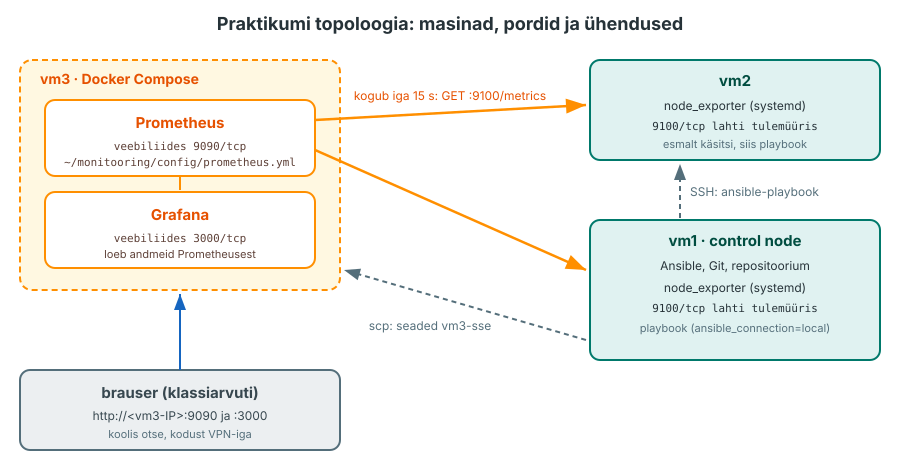

---
tags:
  - Monitooring
  - Ansible
  - Prometheus
  - Grafana
  - Praktikum
---

# Praktikum: mõõdikud ja töölaud

Täna paigaldad node_exporteri kõigepealt käsitsi vm2-sse ja seejärel Ansible'i playbook'iga vm2-sse ja vm1-sse, käivitad vm3-s Prometheuse ja Grafana ning leiad PromQL-iga vastuse küsimusele: millises masinas on ressursse kõige vähem alles?

??? abstract "Õpiväljundid"
    Pärast loengut ja praktikumi oskad:

    1. paigaldada node_exporteri ametlikust väljalaskest systemd teenusena ja kontrollida aadressi `/metrics`;
    2. kirjutada Ansible'i playbook'i, mis paigaldab node_exporteri mitmesse masinasse ja annab teisel käivitusel `changed=0`;
    3. käivitada Prometheuse Docker Compose'iga, kontrollida **Targets**-lehelt, et target'id on olekus `UP`, ja leida seal kogumise vea, kui target on `DOWN`;
    4. koostada PromQL-i päringuid saadaval oleva mälu, failisüsteemi vaba ruumi ja protsessori kasutuse uurimiseks ning selgitada tulemuste ühikuid;
    5. lisada Grafanale andmeallika failiga ja teha töölaua oma päringuga.

<figure markdown="span">
  
  <figcaption>Joonis 1.13. Praktikumi topoloogia: masinad, pordid ja ühendused (Talvik, 2026).</figcaption>
</figure>

Esimesed osad on näidatud tervikuna, järgmised koostad ise sama mustri järgi. Näidislahendus on kokkuvolditud plokis. Ava see, kui jääd kinni või tahad oma lahendust kontrollida. Kui tuleb veateade, ava plokk, mis algab sõnaga **Kui**.

## Osa 1 · Repositoorium ja masinad

Kasutatavad versioonid on node_exporter 1.12.1, Prometheus 3.15.1 ja Grafana 13.2.6. Kõik käsud käivitad vm1-s, nagu DevOps Lite'is.

??? note "Tabel 1.4. Kus mida teed"
    | Masin | Mis seal töötab | Mida seal teed |
    |---|---|---|
    | vm1 | repositoorium, Ansible, node_exporter | kirjutad playbook'i ja seaded, käivitad `ansible-playbook`, salvestad tõendid |
    | vm2 | node_exporter | paigaldad node_exporteri esmalt käsitsi, siis playbook'iga |
    | vm3 | Prometheus ja Grafana Docker Compose'iga | käivitad Prometheuse ja Grafana |
    | klassiarvuti | brauser | vaatad Prometheuse ja Grafana veebiliidest |

Käskudes on masinate nimed `vm2` ja `vm3`. Kui `ssh vm2 hostname` ei vasta, lisa vm1 failile `~/.ssh/config` nimed koos IP-aadressidega:

??? example "Fail `~/.ssh/config` vm1-s"
    ```text
    Host vm2
        HostName <vm2-IP>
        User <kasutaja>
    Host vm3
        HostName <vm3-IP>
        User <kasutaja>
    ```

Kontrolli ühendusi ja eeltingimusi:

```bash
ssh vm2 hostname
ssh vm3 "docker compose version"
ansible-galaxy collection list ansible.posix
```

??? success "Oodatav tulemus"
    `vm2`, Docker Compose'i versioon ja kollektsiooni `ansible.posix` rida.

??? warning "Kui vm3-s ei ole Dockerit"
    DevOps Lite K3-s paigaldas roll `docker` selle vm3-sse. Kui see jäi tegemata, paigalda Docker käsitsi ametliku juhendi [Install Docker Engine on RHEL](https://docs.docker.com/engine/install/rhel/) järgi:

    ```bash
    ssh vm3
    sudo dnf -y install dnf-plugins-core
    sudo dnf config-manager --add-repo https://download.docker.com/linux/rhel/docker-ce.repo
    sudo dnf -y install docker-ce docker-ce-cli containerd.io docker-compose-plugin
    sudo systemctl enable --now docker
    sudo usermod -aG docker $USER
    exit
    ```

    Logi vm3-st välja ja uuesti sisse, et grupp `docker` hakkaks kehtima, ja kontrolli: `ssh vm3 "docker compose version"`.

Prometheuse ja Grafana veebiliides on laborivõrgus kõigile avatud. Ära ava neid internetti. Kodust kasutad neid VPN-iga.

Classroom 50 lingi annab juhendaja. Ava see ja klooni oma repositoorium vm1-sse:

```bash
git clone <sinu-repo-URL>
cd <repo-kaust>
ls konf logid
```

??? success "Oodatav tulemus"
    Kaustas `konf/` on fail `inventory.ini`, kaust `logid/` on tühi. Playbook, Prometheuse ja Grafana seaded lähevad kausta `konf/`, tõendid kausta `logid/`.

Prometheus ja Grafana vajavad vm3-s kokku umbes 500 MB mälu. Vaata, mis seal praegu töötab ja kui palju mälu on vaba:

```bash
ssh vm3 "docker ps --format '{{.Names}}'; free -h"
```

??? success "Oodatav tulemus"
    Real `Mem:` on veerus `available` vähemalt 1 GB. Kui vähem, peata DevOps Lite K3 või K4 pinu selle kausta all käsuga `docker compose stop`. `stop` jätab konteinerid ja andmed alles, hiljem saad pinu käsuga `docker compose start` tagasi. Ära kasuta `docker compose down -v`: võti `-v` kustutaks ka andmebaasi andmeköite.

Pane kirja kolme masina IP-aadressid. Neid on vaja Prometheuse seadetes:

```bash
hostname -I; ssh vm2 hostname -I; ssh vm3 hostname -I
```

Iga masina juures võib olla mitu aadressi. Vali laborivõrgu IPv4-aadress, mitte Dockeri või Podmani sisevõrgu (`172.…`, `10.88.…`) ega loopback-aadress.

Koormuskatseks osas 6 on vaja programmi `stress-ng`, mis on EPEL-i hoidlas. Paigalda see vm2-sse:

```bash
ssh -t vm2 "sudo dnf install -y epel-release && sudo dnf install -y stress-ng && stress-ng --version"
```

`-t` annab `sudo`-le terminali, kus ta saab parooli küsida.

### 1.1 Masin käsitsi

Enne kui monitooring andmeid kogub, vaata, mida vm2 ise näitab. Samad arvud kogub node_exporter hiljem iga 15 sekundi järel.

```bash
ssh vm2 "journalctl -p err -b --no-pager | tail -5"
ssh vm2 "free -h; df -h /; uptime"
```

??? success "Oodatav tulemus"
    `journalctl` näitab selle käivituse veateateid või rida `-- No entries --`. `free` näitab mälu veergudega `total`, `used` ja `available`, `df` juurfailisüsteemi suurust ja vaba ruumi, `uptime` koormust viimase 1, 5 ja 15 minuti keskmisena.

??? question "Küsimus"
    Mida sa nende käskudega ei saa teada?

    ??? success "Vastus"
        Käsud ei näita, milline oli olukord tund aega tagasi. vm1 ja vm3 andmete nägemiseks tuleb igasse eraldi sisse logida. Kui ketas hakkab täis saama, ei teata sellest keegi. Osades 2–7 kogud need arvud kõigist masinatest Prometheusesse ja vaatad neid ajas.

## Osa 2 · node_exporter käsitsi vm2-s

Enne playbook'i teed paigalduse ühes masinas käsitsi, et näha iga sammu tulemust. Hiljem kirjutad samad sammud playbook'iks ja siis tead, mida iga ülesanne teeb.

node_exporter on üks programmifail. Selle ametlikud väljalasked on GitHubis lehel [node_exporter releases](https://github.com/prometheus/node_exporter/releases). Ava versioon **1.12.1** ja leia jaotisest **Assets** kaks faili: Linuxi 64-bitise arhiivi (nimes on `linux-amd64`) ja faili `sha256sums.txt`. Kopeeri nende allalaadimise aadressid (paremklõps, **Copy link address**) ja laadi mõlemad vm2-s kausta `/tmp`:

```bash
ssh vm2
cd /tmp
curl -LO <arhiivi aadress>
curl -LO <sha256sums.txt aadress>
```

Fail `sha256sums.txt` sisaldab iga väljalaske faili SHA-256 kontrollsummat. Käsk `sha256sum --check` arvutab allalaaditud faili summa ja võrdleb seda nimekirjaga. Võti `--ignore-missing` jätab vahele failid, mida sa alla ei laadinud:

```bash
sha256sum --check --ignore-missing sha256sums.txt
```

??? success "Oodatav tulemus"
    `node_exporter-1.12.1.linux-amd64.tar.gz: OK`. Kontrollsumma kinnitab, et fail vastab väljalaskelehel avaldatud summale. Allika usaldusväärsust see ei asenda, sest summa ja fail tulevad samast kohast.

Paki fail lahti, paigalda programm kausta `/usr/local/bin` ja loo talle oma süsteemikasutaja. Teenus ei tööta `root`-ina, sest see ainult loeb masina näitajaid. Muutuja `V` hoiab versiooni:

```bash
V=1.12.1
tar xzf "node_exporter-${V}.linux-amd64.tar.gz"
sudo install -m 0755 "node_exporter-${V}.linux-amd64/node_exporter" /usr/local/bin/
sudo useradd --system --no-create-home --shell /sbin/nologin node_exporter
node_exporter --version
```

`install` loob uue faili, seega saab see kausta `/usr/local/bin` SELinuxi sildi. Kui teisaldad faili käsuga `mv`, jääb alles kausta `/tmp` silt ja systemd ei saa programmi käivitada.

systemd käivitab programmi teenusena, kui sellel on **unit-fail**. Sektsioon `[Unit]` kirjeldab teenust ja käivitusjärjekorda, `[Service]` ütleb, millise kasutajana ja millise käsuga programm käivitub, ning `[Install]` ütleb, millise süsteemi oleku osana teenus koos masinaga käivitub. Ametlik näidis on kaustas [examples/systemd](https://github.com/prometheus/node_exporter/tree/master/examples/systemd), see on tehtud teistsuguse paigalduse jaoks (socket-fail ja keskkonnafail), sinu fail on lihtsam.

Loo vm2-s fail `/etc/systemd/system/node_exporter.service` (`sudo nano`). Esimene sektsioon on antud.

???+ example "Failiosa: [Unit]"
    ```ini
    [Unit]
    Description=Prometheus node_exporter
    After=network-online.target
    ```

Kaks järgmist sektsiooni kirjuta ise:

- `[Service]`: programm käivitub kasutajana `node_exporter` (`User`), käsk on programmi täielik tee `/usr/local/bin/node_exporter` (`ExecStart`) ja kui programm vea tõttu seiskub, käivitab systemd selle uuesti (`Restart=on-failure`);
- `[Install]`: teenus käivitub koos masinaga, kui see on lubatud (`WantedBy=multi-user.target`).

??? example "Näidislahendus: kogu fail"
    ```ini
    [Unit]
    Description=Prometheus node_exporter
    After=network-online.target

    [Service]
    User=node_exporter
    ExecStart=/usr/local/bin/node_exporter
    Restart=on-failure

    [Install]
    WantedBy=multi-user.target
    ```

Kontrolli faili: `sudo systemd-analyze verify /etc/systemd/system/node_exporter.service`. Kui väljund on tühi, leidis systemd failist kõik vajaliku. Pärast unit-faili loomist peab systemd selle uuesti lugema (`daemon-reload`). Käivita teenus ja kontrolli, et see vastab:

```bash
sudo systemctl daemon-reload
sudo systemctl enable --now node_exporter
systemctl is-active node_exporter
curl -s localhost:9100/metrics | grep '^node_memory_MemAvailable_bytes'
```

??? success "Oodatav tulemus"
    `active` ja rida `node_memory_MemAvailable_bytes 1.47e+09` ja sinu arv on teine. See on sama väärtus baitides, mida `free -b` näitab veerus `available`.

??? warning "Kui `systemctl status node_exporter` näitab `status=203/EXEC`"
    systemd ei saa programmi käivitada. Kontrolli SELinuxi silti: `ls -Z /usr/local/bin/node_exporter`. Kui seal on `user_tmp_t`, paranda: `sudo restorecon -v /usr/local/bin/node_exporter`.

Prometheus küsib mõõdikuid vm3-st, seega peab port 9100 vm2-s lahti olema. Ava see tulemüüris ja välju vm2-st:

```bash
sudo firewall-cmd --permanent --add-port=9100/tcp && sudo firewall-cmd --reload
exit
```

## Osa 3 · Mida /metrics sisaldab

node_exporter avaldab sadu mõõdikuid. Vaata vm1-st nelja, mida kasutad hiljem PromQL-is, ja salvesta need tõendiks:

```bash
curl -fsS http://<vm2-IP>:9100/metrics | grep -E '^node_(cpu_seconds_total|memory_MemAvailable_bytes|memory_MemTotal_bytes|filesystem_avail_bytes)' > logid/k1-metrics.txt
cat logid/k1-metrics.txt
```

??? question "Ennusta"
    Mitu rida on failis mõõdikul `node_cpu_seconds_total`? Vihje: `ssh vm2 nproc`.

    ??? success "Vastus"
        Loogiliste protsessorite arv korda kaheksa. Iga protsessori kohta on kaheksa `mode` väärtust (`idle`, `user`, `system`, `iowait`, `irq`, `softirq`, `nice`, `steal`). Mõõdiku nimi koos siltide väärtustega määrab ühe aegrea.

```bash
grep -c '^node_cpu_seconds_total' logid/k1-metrics.txt
curl -fsS http://<vm2-IP>:9100/metrics | grep -E '^# TYPE node_(memory_MemAvailable_bytes|cpu_seconds_total) '
```

??? question "Gauge ja counter"
    Mis tüüpi on kumbki mõõdik ja mis on nende ühik? Kuidas tunned counteri ära ka ilma `# TYPE` reata?

    ??? success "Vastus"
        `node_memory_MemAvailable_bytes` on gauge, ühik baidid. `node_cpu_seconds_total` on counter, ühik sekundid. Counteri nimi lõpeb Prometheuse nimetustava järgi järelliitega `_total` ([Metric and label naming](https://prometheus.io/docs/practices/naming/)).

## Osa 4 · Sama playbook'iga kahes masinas

vm1 vajab samu samme. Käsitsi võib teises masinas mõne sammu teisiti teha, playbook teeb igas masinas samad sammud. Koostad playbook'i `konf/node_exporter.yml` ülesannete kaupa: lisad ülesande, käivitad playbook'i ja vaatad tulemust. Iga ülesanne vastab ühele osa 2 sammule.

Starteris on fail `konf/inventory.ini`. vm1 on control node ja jälgitav masin korraga: `ansible_connection=local` paneb Ansible'i vm1 ülesandeid käivitama kohapeal, ilma SSH-ta.

```ini
[jalgitavad]
vm2
vm1 ansible_connection=local
```

??? note "Tabel 1.5. Playbook'i moodulid"
    | Moodul | Mida teeb | Osa 2 samm |
    |---|---|---|
    | [`ansible.builtin.get_url`](https://docs.ansible.com/ansible/latest/collections/ansible/builtin/get_url_module.html) | laadib faili alla ja kontrollib kontrollsummat | `curl` ja `sha256sum` |
    | [`ansible.builtin.unarchive`](https://docs.ansible.com/ansible/latest/collections/ansible/builtin/unarchive_module.html) | pakib arhiivi lahti | `tar` |
    | [`ansible.builtin.copy`](https://docs.ansible.com/ansible/latest/collections/ansible/builtin/copy_module.html) | kopeerib faili või kirjutab sisu faili | `install`, unit-fail |
    | [`ansible.builtin.user`](https://docs.ansible.com/ansible/latest/collections/ansible/builtin/user_module.html) | loob kasutaja | `useradd` |
    | [`ansible.builtin.systemd_service`](https://docs.ansible.com/ansible/latest/collections/ansible/builtin/systemd_service_module.html) | käivitab teenuse, loeb unit-failid uuesti | `systemctl` |
    | [`ansible.posix.firewalld`](https://docs.ansible.com/ansible/latest/collections/ansible/posix/firewalld_module.html) | avab pordi firewalld-s | `firewall-cmd` |

### 4.1 Play ja allalaadimine

Versioon ja aadressid on muutujates, et versiooni vahetamiseks piisaks ühest reast. `checksum` võtab summa veebiaadressilt `sha256sums.txt`: kui fail ei vasta, ülesanne ebaõnnestub.

???+ example "Ülesanne: play algus ja allalaadimine"
    ```yaml
    - name: node_exporter jälgitavatesse masinatesse
      hosts: jalgitavad
      become: true
      vars:
        ne_version: "1.12.1"
        ne_name: "node_exporter-{{ ne_version }}.linux-amd64"
        ne_url: "https://github.com/prometheus/node_exporter/releases/download/v{{ ne_version }}"
      tasks:
        - name: Väljalase alla koos kontrollsummaga
          ansible.builtin.get_url:
            url: "{{ ne_url }}/{{ ne_name }}.tar.gz"
            dest: "/tmp/{{ ne_name }}.tar.gz"
            checksum: "sha256:{{ ne_url }}/sha256sums.txt"
    ```

```bash
ansible-playbook -i konf/inventory.ini konf/node_exporter.yml -K
```

`-K` küsib `sudo` parooli üks kord ja kasutab seda mõlemas masinas.

??? success "Oodatav tulemus"
    Ülesanne on vm1-s `changed`. vm2-s laadisid osas 2 sama arhiivi kausta `/tmp`, seal on see `ok`, kui fail on alles ja kontrollsumma klapib.

??? question "Kontrollsumma kuju"
    Leia `ansible-doc ansible.builtin.get_url` väljundist parameetri `checksum` kirjeldus: kirjuta `/checksum` ja vajuta **Enter**. Mis kujul saab kontrollsumma anda?

    ??? success "Vastus"
        Kahel kujul: `<algoritm>:<summa>` otse või `<algoritm>:<URL>`, kus URL viitab failile, milles on summa koos failinimega.

### 4.2 Lahtipakkimine ja programm

Arhiiv ja programm on juba sihtmasinas, seda ütleb `remote_src: true`. `creates` jätab lahtipakkimise vahele, kui programm on juba lahti pakitud, muidu oleks ülesanne igal käivitusel `changed`.

???+ example "Ülesanne: arhiiv lahti ja programm kausta /usr/local/bin"
    ```yaml
        - name: Arhiiv lahti
          ansible.builtin.unarchive:
            src: "/tmp/{{ ne_name }}.tar.gz"
            dest: /tmp
            remote_src: true
            creates: "/tmp/{{ ne_name }}/node_exporter"

        - name: Programm kausta /usr/local/bin
          ansible.builtin.copy:
            src: "/tmp/{{ ne_name }}/node_exporter"
            dest: /usr/local/bin/node_exporter
            remote_src: true
            mode: "0755"
    ```

Käivita playbook ja kontrolli: `/usr/local/bin/node_exporter --version`.

??? success "Oodatav tulemus"
    vm1-s on kaks uut ülesannet `changed`. vm2-s on lahtipakkimine `skipping` ja programmi ülesanne `ok`. `--version` näitab `node_exporter, version 1.12.1`.

### 4.3 Kasutaja

Alates siit kirjutad ülesanded ise. Lisa ülesanne, mis teeb sama, mis osas 2 käsk `useradd`: süsteemikasutaja `node_exporter` ilma kodukaustata ja ilma sisselogimisõiguseta. Leia `ansible-doc ansible.builtin.user` väljundist parameetrid, mis vastavad võtmetele `--system`, `--shell` ja `--no-create-home`.

??? example "Näidislahendus"
    ```yaml
        - name: Süsteemikasutaja node_exporter
          ansible.builtin.user:
            name: node_exporter
            system: true
            shell: /sbin/nologin
            create_home: false
    ```

### 4.4 Unit-fail ja handler

Lisa ülesanne, mis kirjutab faili `/etc/systemd/system/node_exporter.service` õigustega `0644` ja sisuga osast 2. Sobib moodul `copy` parameetriga `content: |`. Ülesanne teavitab handler'it `node_exporter uuesti`. Handler taaskäivitab teenuse mooduliga `ansible.builtin.systemd_service`, aga enne peab systemd unit-faili uuesti lugema. Leia `ansible-doc ansible.builtin.systemd_service` väljundist parameeter, mis teeb `daemon-reload`-i.

??? example "Näidislahendus: unit-fail ja handler"
    ```yaml
        - name: Unit-fail, sama sisu mis osas 2
          ansible.builtin.copy:
            dest: /etc/systemd/system/node_exporter.service
            mode: "0644"
            content: |
              [Unit]
              Description=Prometheus node_exporter
              After=network-online.target

              [Service]
              User=node_exporter
              ExecStart=/usr/local/bin/node_exporter
              Restart=on-failure

              [Install]
              WantedBy=multi-user.target
          notify: node_exporter uuesti
    ```

    Plokk `handlers:` on samal tasemel kui `tasks:`:

    ```yaml
      handlers:
        - name: node_exporter uuesti
          ansible.builtin.systemd_service:
            name: node_exporter
            state: restarted
            daemon_reload: true
    ```

??? question "Ennusta"
    Kas unit-faili ülesanne on vm2-s `changed` või `ok`? Kas handler käivitub vm2-s ja vm1-s?

    ??? success "Vastus"
        vm1-s on unit-fail `changed` ja play lõpus käivitub handler. vm2-s on see `ok` ja handler ei käivitu, kui sisu on täpselt sama mis osas 2. Kui see on `changed`, erines sisu millegi poolest, näiteks tühiku või tühja rea võrra.

### 4.5 Teenus ja port

Need kaks ülesannet teevad sama, mis osas 2 `systemctl enable --now` ja `firewall-cmd`. Teenus `node_exporter` töötab ja käivitub koos masinaga, selleks on moodul `systemd_service`. Port `9100/tcp` on lubatud kohe ja jääb alles pärast taaskäivitust, selleks on moodul `ansible.posix.firewalld` parameetritega `immediate` ja `permanent`.

??? example "Näidislahendus: teenus ja port"
    ```yaml
        - name: Teenus töötab ja käivitub koos masinaga
          ansible.builtin.systemd_service:
            name: node_exporter
            state: started
            enabled: true
            daemon_reload: true

        - name: Port 9100 tulemüüris
          ansible.posix.firewalld:
            port: 9100/tcp
            permanent: true
            immediate: true
            state: enabled
    ```

### 4.6 Kaks käivitust

Kui kõik ülesanded on lisatud, käivita playbook kaks korda. Teise käivituse väljund läheb tõendiks:

```bash
ansible-playbook -i konf/inventory.ini konf/node_exporter.yml -K
ansible-playbook -i konf/inventory.ini konf/node_exporter.yml -K | tee logid/k1-teine-kaivitus.txt
```

??? success "Oodatav tulemus"
    Teisel käivitusel on mõlema masina real `changed=0` ja `failed=0`.

??? warning "Kui teisel käivitusel on `changed=1`"
    Tavaliselt on põhjus `command` või `shell` ülesanne, mis käivitub iga kord. Kasuta mooduleid tabelist 1.5. Kui muutub unit-faili ülesanne, kontrolli, et `content:` ei sõltu ajast ega muutujast, mis iga kord muutub.

Kontrolli, et mõlemad masinad vastavad:

```bash
for ip in <vm1-IP> <vm2-IP>; do curl -fsS http://$ip:9100/metrics | grep -c '^node_'; done
```

## Osa 5 · Prometheus vm3-s

Prometheus töötab vm3-s konteineris. Kirjutad kaks faili: Prometheuse seaded ja Compose'i faili. Seadete võtmed on kirjeldatud lehel [Configuration](https://prometheus.io/docs/prometheus/latest/configuration/configuration/) ja konteinerina käivitamine lehel [Installation, Using Docker](https://prometheus.io/docs/prometheus/latest/installation/#using-docker).

**Seaded, `konf/prometheus.yml`.** `scrape_interval` ütleb, kui tihti Prometheus kõiki target'eid küsib. `scrape_configs` on loend job'e. Igal job'il on nimi (`job_name`, sellest tuleb silt `job`) ja `static_configs`, mille all `targets` on aadresside loend kujul `"<IP>:<port>"`. Esimene job küsib Prometheust ennast.

???+ example "Failiosa: global ja job prometheus"
    ```yaml
    global:
      scrape_interval: 15s

    scrape_configs:
      - job_name: prometheus
        static_configs:
          - targets: ["localhost:9090"]
    ```

Teise job'i kirjuta ise samasse `scrape_configs` loendisse: `job_name` on `node` ja `targets` loendis on mõlemad node_exporterid pordiga 9100. Kasuta IP-aadresse, mitte SSH nimesid: Prometheus konteineris ei tunne nimesid `vm1` ja `vm2`.

??? example "Näidislahendus: job node"
    ```yaml
      - job_name: node
        static_configs:
          - targets: ["<vm2-IP>:9100", "<vm1-IP>:9100"]
    ```

**Compose'i fail, `konf/compose.yaml`.** Teenus kasutab image'it kindla sildiga ([sildid Docker Hubis](https://hub.docker.com/r/prom/prometheus/tags)), et sama fail annaks ka hiljem sama tulemuse.

???+ example "Failiosa: teenus, image ja port"
    ```yaml
    services:
      prometheus:
        image: prom/prometheus:v3.15.1
        ports:
          - "9090:9090"
        restart: unless-stopped
    ```

Ühendused (`volumes`) kirjuta ise:

- kaust `./config` on konteineris kaustas `/etc/prometheus`, ainult lugemiseks (`:ro`). Kaust, mitte üksik fail: kui fail hiljem uuega asendatakse, näeb konteiner kausta kaudu uut faili;
- nimega andmeköide `prometheus-data` on konteineris kaustas `/prometheus`, nii et andmed jäävad alles ka siis, kui konteiner luuakse uuesti;
- nimega andmeköide on kirjeldatud ka faili lõpus, ilma taandeta.

??? example "Näidislahendus: ühendused ja andmeköide"
    ```yaml
        volumes:
          - ./config:/etc/prometheus:ro
          - prometheus-data:/prometheus
    ```

    ```yaml
    volumes:
      prometheus-data:
    ```

Kopeeri failid vm3-sse ja käivita. Kaust `~/monitooring` on vm3-s Compose'i projekti kaust, `prometheus.yml` läheb selle alamkausta `config/`:

```bash
ssh vm3 "mkdir -p ~/monitooring/config"
scp konf/compose.yaml vm3:monitooring/
scp konf/prometheus.yml vm3:monitooring/config/
ssh vm3 "cd ~/monitooring && docker compose up -d && docker compose ps"
```

??? success "Oodatav tulemus"
    Konteiner `monitooring-prometheus-1` on olekus `Up`. Ava klassiarvuti brauseris `http://<vm3-IP>:9090`.

??? warning "Kui konteiner taaskäivitub ja logis on `permission denied` või `no such file` faili `prometheus.yml` kohta"
    Vaata logi: `ssh vm3 "cd ~/monitooring && docker compose logs prometheus | tail"`. Kontrolli, et fail on kaustas `~/monitooring/config/` ja on loetav: Prometheus töötab konteineris kasutajana `nobody`. Kui Docker kasutab SELinuxi, lisa kaustale märge `:ro,Z` (`./config:/etc/prometheus:ro,Z`) ja käivita uuesti `docker compose up -d`.

Ava veebiliideses **Status → Target health**. Seal on kolm target'it: Prometheus ise ja kaks node_exporterit. Salvesta Prometheuse vaade tõendiks:

```bash
ssh vm3 "curl -fsS localhost:9090/api/v1/targets" > logid/k1-targets.json
grep -o '"health":"[a-z]*"' logid/k1-targets.json
```

??? success "Oodatav tulemus"
    Kolm rida `"health":"up"`. Targets-lehel on mõlemad node_exporterid olekus `UP`, **Last scrape** on alla 15 sekundi tagasi ja **Error** on tühi. Kui mõni on `DOWN`, vaata **Error** veergu ja loengu tabelit 1.2.

### 5.1 Kogumisvea katse

Nüüd tekitad kogumisvea meelega ja leiad selle Prometheusest.

??? question "Ennusta"
    Mis olek, **Error** ja `up` väärtus on vm1 target'il, kui peatad seal node_exporteri?

    ??? success "Vastus"
        Olek `DOWN`, **Error** on näiteks `Get "http://192.168.125.21:9100/metrics": dial tcp 192.168.125.21:9100: connect: connection refused` ja päring `up` annab vm1 kohta 0.

Peata node_exporter vm1-s, kus sa praegu töötad:

```bash
sudo systemctl stop node_exporter
```

Oota vähemalt 15 sekundit, värskenda Targets-lehte ja salvesta tõend, kui vm1 target on `DOWN`:

```bash
ssh vm3 "curl -fsS localhost:9090/api/v1/targets" > logid/k1-viga.json
grep -o '"lastError":"[^"]*"' logid/k1-viga.json
```

Taasta soovitud olek playbook'iga. Playbook nõuab, et teenus on olekus `started`, seega käivitab see node_exporteri uuesti:

```bash
ansible-playbook -i konf/inventory.ini konf/node_exporter.yml -K
```

Kontrolli Targets-lehelt, et mõlemad on jälle `UP`.

## Osa 6 · Kolm küsimust PromQL-iga

Ava veebiliideses **Query**. Kirjuta päring, vajuta **Execute** ja vaata vahekaarte **Table** ja **Graph**. Iga küsimus lisab päringukeelest ühe osa, selgitus on loengu 6. peatükis.

### 6.1 Kui palju mälu on masinas saadaval?

```text
node_memory_MemAvailable_bytes
node_memory_MemAvailable_bytes{instance="<vm2-IP>:9100"}
```

??? question "Miks annab üks mõõdiku nimi mitu tulemust?"
    Vaata tulemuse ridade silte. Milline silt on igal real erinev? Mis ühikus on väärtus ja kui palju on see gigabaitides?

    ??? success "Vastus"
        Rida iga target'i kohta, sest silt `instance` on erinev. Väärtus on baitides, näiteks `1.47e+09` on umbes 1,4 GiB.

Masinas on ka mõõdik `node_memory_MemFree_bytes`. Kontrolli, kumb on suurem, ja seejärel muuda päringut nii, et see näitab iga masina saadaval olevat mälu protsentides kogu mälust (`node_memory_MemTotal_bytes`).

??? tip "Vihje"
    Kaks mõõdikut saab jagada nagu arve, Prometheus paaritab read samade siltide järgi, nagu on loengu joonisel 1.8. Protsendi saamiseks korruta tulemus.

??? success "Oodatav tulemus"
    `MemAvailable` on suurem kui `MemFree`. `MemFree` jätab välja puhvri- ja vahemälu, mille tuum vajadusel vabastab. Osakaalu päring `node_memory_MemAvailable_bytes / node_memory_MemTotal_bytes * 100` annab iga masina kohta arvu 0 ja 100 vahel.

### 6.2 Millises masinas on juurfailisüsteemis kõige vähem vaba ruumi?

Selle päringu koostad ise. Vaja on kahte mõõdikut: `node_filesystem_avail_bytes` ja `node_filesystem_size_bytes`. Kirjuta kõigepealt ainult esimese nimi ja vaata, mitu rida tuleb iga masina kohta. Seejärel kirjuta päring, mis annab iga masina juurfailisüsteemi (`/`) vaba ruumi protsentides.

??? tip "Vihje"
    Iga failisüsteemi kohta on eraldi rida, silt `mountpoint` ütleb, mis failisüsteem see on. Sildifilter käib mõlema mõõdiku juurde.

??? example "Näidislahendus"
    ```text
    node_filesystem_avail_bytes{mountpoint="/"} / node_filesystem_size_bytes{mountpoint="/"} * 100
    ```

### 6.3 Kuidas muutub protsessori kasutus koormuskatse ajal?

Protsessori kasutuse päring koosneb neljast osast. Kaks esimest on antud:

```text
node_cpu_seconds_total{mode="idle"}
rate(node_cpu_seconds_total{mode="idle"}[1m])
```

Kolmanda ja neljanda osa koostad ise: esmalt protsessorite keskmine, üks rida masina kohta, siis jõudeaja osakaalust protsessori kasutus protsentides.

??? tip "Vihje"
    Keskmise silti `instance` kaupa annab koondamisoperaator `avg` koos võtmesõnaga `by` ([Aggregation operators](https://prometheus.io/docs/prometheus/latest/querying/operators/#aggregation-operators)). Kasutus on see osa ajast, mis ei olnud jõudeaeg.

??? example "Näidislahendus"
    ```text
    avg by (instance) (rate(node_cpu_seconds_total{mode="idle"}[1m]))
    100 * (1 - avg by (instance) (rate(node_cpu_seconds_total{mode="idle"}[1m])))
    ```

Pane neljas päring vahekaardile **Graph** ja tekita vm2-s 60 sekundiks koormus. `$(nproc)` on masina loogiliste protsessorite arv, igaühele tuleb üks koormav protsess:

```bash
date +%T; ssh vm2 'stress-ng --cpu $(nproc) --timeout 60s'; date +%T
```

??? question "Kas graafiku muutus algas ja lõppes täpselt samal hetkel kui katse?"
    Võrdle graafikut käsu algus- ja lõpuajaga.

    ??? success "Vastus"
        Ei. Enne ja pärast on kasutus mõne protsendi juures, katse ajal 100 lähedal, aga servad on kaldu ja nihkes. Prometheus kogub iga 15 sekundi järel ja `rate(...[1m])` on viimase minuti keskmine, seega jõuab muutus graafikule täielikult alles umbes minuti jooksul.

### 6.4 Võrdlus

Kirjuta päring, mis tagastab ainult masinad, kus juurfailisüsteemis on vaba ruumi alla 99%. Seejärel muuda piiri nii, et tulemusse jääb ainult üks masin. K2-s saab sellisest päringust alarmireegel.

??? tip "Vihje"
    Võta oma 6.2 päring ja lisa selle lõppu võrdlus nagu loengu joonisel 1.12. Tühi tulemus tähendab, et tingimus ei kehti ühegi masina kohta.

## Osa 7 · Grafana

Prometheuse veebiliides sobib päringu koostamiseks, töölaua jaoks lisad samasse Compose'i projekti Grafana. Andmeallika kirjeldad failiga, et see tekiks igas uues konteineris ise ([Provisioning, Data sources](https://grafana.com/docs/grafana/latest/administration/provisioning/#data-sources)). Compose'i võrgus leiab Grafana Prometheuse teenuse nime järgi, seega on aadress `http://prometheus:9090`.

??? example "Fail `konf/grafana-datasource.yml`"
    ```yaml
    apiVersion: 1

    datasources:
      - name: Prometheus
        type: prometheus
        access: proxy
        url: http://prometheus:9090
        isDefault: true
    ```

Lisa faili `konf/compose.yaml` teenus `grafana` ([Run Grafana Docker image](https://grafana.com/docs/grafana/latest/setup-grafana/installation/docker/)): image `grafana/grafana:13.2.6`, port `3000:3000`, `restart: unless-stopped`, kaust `./grafana` konteineris kaustas `/etc/grafana/provisioning/datasources` ainult lugemiseks ja nimega andmeköide `grafana-data` kaustas `/var/lib/grafana`. Lisa `grafana-data` ka faili lõpus olevasse `volumes:` plokki.

??? example "Näidislahendus: teenus grafana"
    ```yaml
      grafana:
        image: grafana/grafana:13.2.6
        ports:
          - "3000:3000"
        volumes:
          - ./grafana:/etc/grafana/provisioning/datasources:ro
          - grafana-data:/var/lib/grafana
        restart: unless-stopped
    ```

    ```yaml
    volumes:
      prometheus-data:
      grafana-data:
    ```

```bash
ssh vm3 "mkdir -p ~/monitooring/grafana"
scp konf/grafana-datasource.yml vm3:monitooring/grafana/prometheus.yml
scp konf/compose.yaml vm3:monitooring/
ssh vm3 "cd ~/monitooring && docker compose up -d && docker compose ps"
```

??? question "Ennusta"
    Kas `docker compose up -d` taaskäivitab ka Prometheuse konteineri?

    ??? success "Vastus"
        Ei. Compose loob uue konteineri ainult teenusele, mille kirjeldus muutus. Prometheuse kirjeldus jäi samaks ja konteiner töötab edasi, väljundis on `Running`.

Ava `http://<vm3-IP>:3000`. Esimene sisselogimine on `admin` ja `admin`, Grafana palub kohe uue parooli. Kontrolli **Connections → Data sources → Prometheus** lehe allosas nupuga **Save & test**, et Grafana jõuab Prometheuseni.

??? warning "Kui andmeallikat pole või test annab vea"
    Vaata logi: `ssh vm3 "cd ~/monitooring && docker compose logs grafana | grep -i provisioning"`. Kontrolli, et fail on vm3-s kaustas `~/monitooring/grafana/` ja et `url` on `http://prometheus:9090`, mitte `localhost`: konteineris tähendab `localhost` Grafana konteinerit ennast.

**Oma paneel.** Tee uus töölaud: **Dashboards → New → New dashboard → Add visualization**, vali andmeallikas **Prometheus**. Lülita päringuväli režiimi **Code** ja kirjuta osa 6.1 päring, mis näitab saadaval mälu baitides masinate kaupa. Paneeli seadetes paremal pane **Standard options → Unit** väärtuseks **bytes(IEC)** ja päringu all **Options → Legend** väärtuseks **Custom** `{{instance}}`. Anna paneelile pealkiri, salvesta töölaud nimega `K1`.

??? success "Oodatav tulemus"
    Graafikul on kaks joont, kumbki ühe masina saadaval mälu, teljel ühikud MiB või GiB, legendis masinate aadressid.

Lisa samale töölauale teine paneel oma 6.3 protsessori kasutuse päringuga (**Unit**: **Percent (0-100)**). Käivita koormuskatse uuesti ja vaata, kas Grafanas on sama kuju mis Prometheuse graafikul.

Salvesta töölaud repositooriumisse. Töölaua menüüs **Export → Export as JSON** vali **Copy to clipboard**, loo vm1 repositooriumis fail `konf/toolaud.json` ja kleebi sisu sinna.

**Valmis töölaud.** Impordi kogukonna töölaud Node Exporter Full: **Dashboards → New → Import**, ID `1860`, **Load**, andmeallikaks **Prometheus**, **Import**. Leia sealt oma masinate mälu ja ketta näit ning ava ühe paneeli **Edit**, et näha selle PromQL-i päringut ([Import dashboards](https://grafana.com/docs/grafana/latest/dashboards/build-dashboards/import-dashboards/)).

??? warning "Kui ID järgi importimine ebaõnnestub"
    ID järgi laadib töölaua alla vm3, millel ei pruugi olla ligipääsu aadressile grafana.com. Ava klassiarvuti brauseris [Node Exporter Full](https://grafana.com/grafana/dashboards/1860) leht, vajuta **Download JSON** ja lae fail importimise lehel üles (**Upload dashboard JSON file**).

??? question "Valmis või oma töölaud"
    Millal kasutaksid valmis töölauda ja millal oma paneeli?

    ??? success "Vastus"
        Valmis töölaud annab kiire ülevaate kõigest, mida exporter avaldab. Kindla küsimuse jaoks, näiteks millises masinas on mälu kõige vähem, on oma paneel selgem: seal on ainult vajalik päring, õige ühik ja masinate nimed legendis.

## Osa 8 · Kokkuvõte

??? question "Millises masinas on ressursse kõige vähem alles?"
    Põhjenda osa 6 kolme küsimuse tulemustega: saadaval mälu protsentides, juurfailisüsteemi vaba ruum ja protsessori kasutus. Milline andmeliik aitaks põhjust leida, kui ühes masinas hakkab ketas kiiresti täituma?

    ??? success "Vastus"
        Vastus sõltub sinu masinatest. Põhjus: logid (K3) näitavad, mis protsess või teenus kirjutab, mõõdik näitab ainult, et ruum väheneb.

Prometheus ja Grafana vm3-s ning node_exporterid vm1-s ja vm2-s jäävad tööle. K2 alustab neist: alarmireegel tuleb päringust 6.4.

??? note "Kontrollnimekiri"
    - [ ] node_exporter töötab vm1-s ja vm2-s ning käivitub koos masinaga.
    - [ ] Playbook'i teine käivitus annab mõlemas masinas `changed=0`.
    - [ ] Prometheus töötab vm3-s ja Targets-lehel on mõlemad node_exporterid olekus `UP`.
    - [ ] Kogumisvea katse on tehtud, tõend on kaustas `logid/` ja node_exporter on uuesti käivitatud.
    - [ ] Grafanas on töölaud mälu ja protsessori paneeliga ning see on salvestatud faili `konf/toolaud.json`.

## Töö esitamine

Repositooriumis on playbook, Prometheuse ja Grafana seaded, töölaud ja tõendid kaustas `logid/`. Vaata `git status` väljund enne lisamist läbi: repositooriumisse ei lähe paroole ega SSH-võtmeid.

```bash
git status
git add README.md konf logid
git commit -m "K1: node_exporter, Prometheus ja Grafana"
git push
```

Tulemuse näed Classroom 50-s.

## Lisaülesanded

??? example "1 · Oma silt"
    Lisa `prometheus.yml`-is target'itele silt `roll`: vm2 on `veeb`, vm1 on `juhtsolm` (vaata `static_configs` võtit `labels` dokumentatsioonist [static_config](https://prometheus.io/docs/prometheus/latest/configuration/configuration/#static_config)). Kopeeri fail uuesti kausta `vm3:monitooring/config/` ja loe seaded uuesti ilma taaskäivituseta: `ssh vm3 "cd ~/monitooring && docker compose kill -s HUP prometheus"`. Lisa Grafana töölauale muutuja `roll` (**Settings → Variables**, päring `label_values(up, roll)`) ja kasuta seda paneeli päringus.

??? example "2 · Kas target vastab"
    Kirjuta päring, mis tagastab ainult target'id, mille kogumine ebaõnnestus (`up == 0`). Kui tihti Prometheus target'it küsib (`scrape_interval`) ja kui kaua ta vastust ootab (`scrape_timeout`, vaikimisi 10 s)? Peata vm2-s node_exporter ja kontrolli, kui kaua läheb, enne kui päring midagi tagastab.

??? example "3 · Mitu aegrida"
    Päring `count({__name__=~"node_.*"})` loeb kõik node_exporteri aegread. Leia päringuga `topk(5, count by (__name__) ({__name__=~"node_.*"}))`, millistel mõõdikutel on kõige rohkem aegridu ja miks.

??? example "4 · Seaded Ansible'iga"
    Kirjuta playbook `konf/monitooring.yml`, mis kopeerib vm3-sse `compose.yaml`, `prometheus.yml` ja andmeallika faili ning käivitab projekti mooduliga [`community.docker.docker_compose_v2`](https://docs.ansible.com/ansible/latest/collections/community/docker/docker_compose_v2_module.html). Teine käivitus peab andma `changed=0`.
