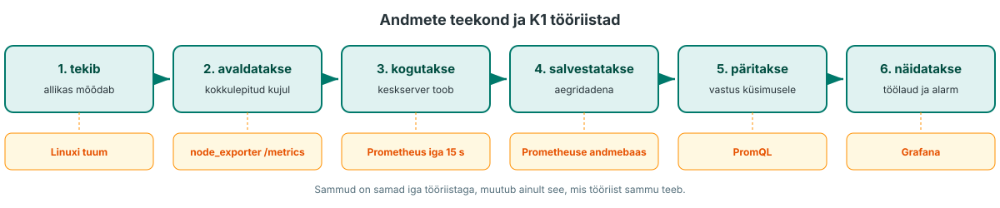
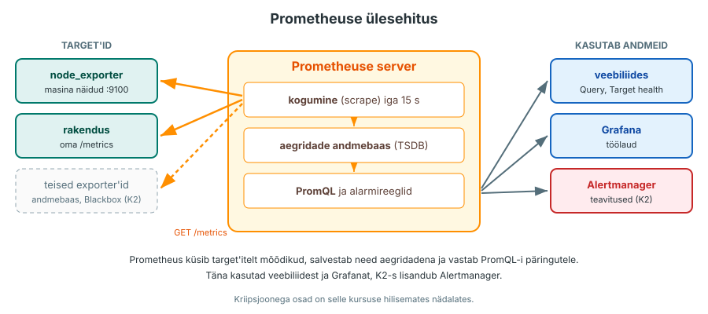
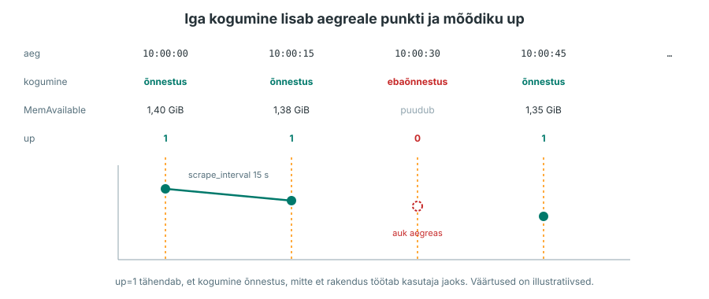
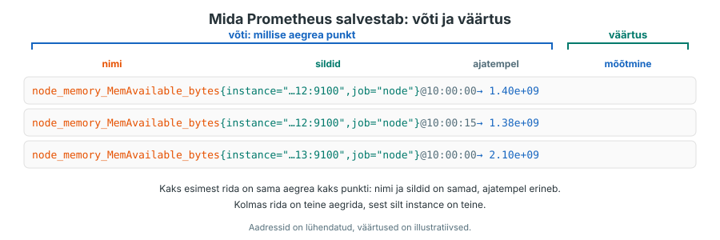
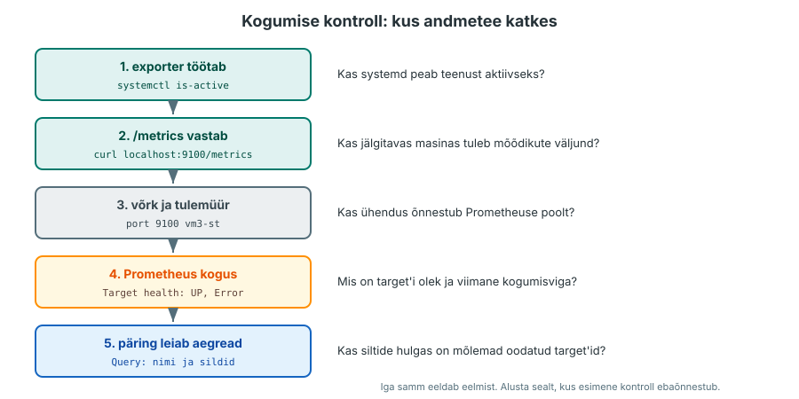
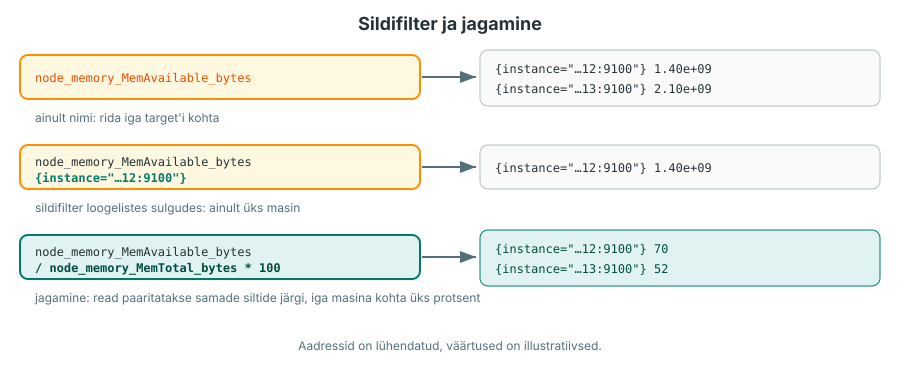
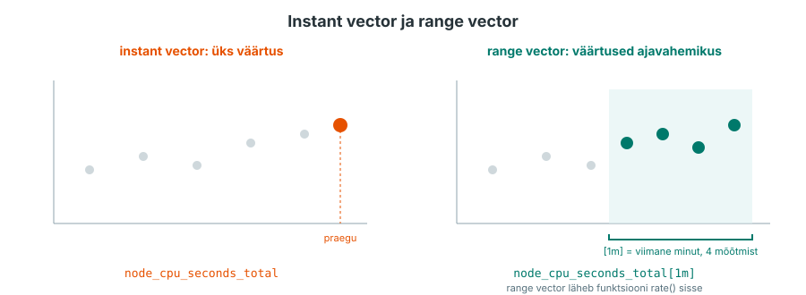
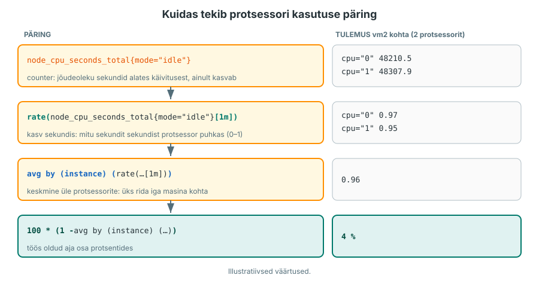
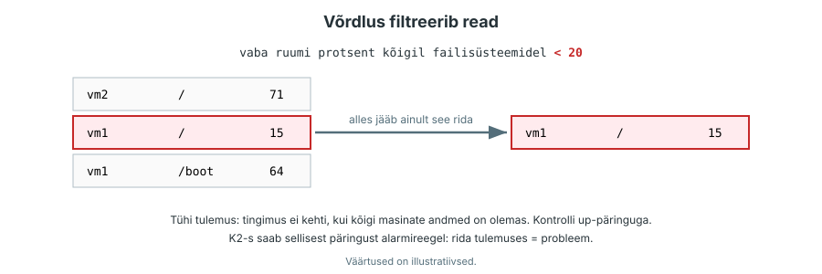

---
tags:
  - Loeng
  - Monitooring
  - Prometheus
  - Grafana
---

# Loeng: mõõdikud ja töölaud

DevOps Lite'is paigaldasid Ansible'i ja Compose'iga teenused kolme masinasse. Kuidas tead, kas need töötavad ja kas masinatel jätkub ressursse? Loeng algab sellest, mida Linux ühes masinas ise näitab, ja jõuab selleni, miks andmed kogutakse keskselt. Seejärel paned masinad jälgimise alla: node_exporter avaldab iga masina mõõdikud, Prometheus küsib need ise ja salvestab, päringud koostad PromQL-iga ja Grafana näitab tulemust töölaual. Kogu kohtumise läbiv küsimus on: **millises masinas on ressursse kõige vähem alles?**

??? abstract "Õpiväljundid"
    Pärast loengut ja praktikumi oskad:

    - leida Linuxi masinast logikirjed ja ressursside hetkenäidud ning selgitada, miks neist ei piisa;
    - eristada mõõdikut, sündmust, logi ja jälge ning selgitada, millisele küsimusele igaüks vastab;
    - selgitada seire ja jälgitavuse erinevust;
    - kasutada USE meetodit masina ressursside jälgimiseks ja nimetada teenuse neli kuldset signaali;
    - selgitada pull- ja push-mudeli erinevust ning seda, kes Prometheuse puhul avab ühenduse ja kes tagastab väärtused;
    - lugeda exporter'i väljundist mõõdiku nime, silte, väärtust, tüüpi ja ühikut;
    - kontrollida Prometheuse kogumist sammhaaval: exporter, `/metrics`, Targets-leht, päring;
    - koostada PromQL-i päringuid saadaval oleva mälu, failisüsteemi vaba ruumi ja protsessori kasutuse uurimiseks;
    - luua Grafanasse Prometheuse andmeallika ja lisada paneeli oma PromQL-i päringuga.

## 1. Üks masin: mida Linux ise näitab

Ketas täitub öösel ja teenus lakkab töötamast. Kuidas oleksid seda enne märganud ja kust näeksid hommikul, mis juhtus? Vastus algab sellest, mida masin ise näitab.

Iga Linuxi masin kirjutab sündmused logisse ja näitab käskudega, kui palju ressursse on kasutusel. AlmaLinuxis kogub logid teenus **journald** ja neid loeb käsk `journalctl`. Logikirjel on aeg, masin, programm ja tekst.

```bash
journalctl -p err -b            # selle käivituse vead
journalctl -u sshd --since "1 hour ago"
```

```text
nov 20 09:14:02 vm2 sshd[1532]: Failed password for kasutaja from 192.168.125.40 port 52144 ssh2
nov 20 09:15:40 vm2 kernel: Out of memory: Killed process 2211 (java)
```

Ressursside hetkeseisu näitavad `free`, `df` ja `top`. Iga rida on üks arv ühel hetkel: kui palju mälu on saadaval, kui palju kettaruumi on vaba ja kui hõivatud on protsessor.

```bash
free -h       # mälu: total, used, available
df -h /       # juurfailisüsteemi vaba ruum
uptime        # koormus viimase 1, 5 ja 15 minuti keskmisena
```

Ühe masina juures sellest piisab. Kolme või viiekümne masinaga tekivad kolm probleemi. Käsud näitavad ainult praegust hetke ja öösel olnud riket enam ei näe. Igasse masinasse tuleb eraldi sisse logida. Keegi ei anna teada, kui ketas hakkab täis saama. Monitooring lahendab need: andmed kogutakse kõigist masinatest ühte kohta, hoitakse ajas alles ja reeglid teatavad, kui midagi läheb valesti.

??? question "Kontrolli ennast"
    1. Millise käsuga näed ainult teenuse `nginx` logikirjeid viimasest tunnist?
    2. Miks ei piisa `free -h` väljundist, kui rike oli eile öösel?

    ??? success "Vastused"
        1. `journalctl -u nginx --since "1 hour ago"`.
        2. `free` näitab ainult praegust hetke. Eilse olukorra nägemiseks peab mälu väärtust regulaarselt koguma ja salvestama.

## 2. Andmed: mida süsteem endast annab

Monitooring ja jälgitavus põhinevad samadel andmetel. Andmed, mida süsteem enda kohta välja annab, on **telemeetria** (telemetry). Telemeetriat tekitavad operatsioonisüsteem, teenused nagu nginx ja andmebaas, rakenduse kood, võrguseadmed ja kasutaja brauser. Hajusas süsteemis on selliseid allikaid kümneid kuni tuhandeid.

Telemeetriat on nelja liiki ja nende ingliskeelsete nimede algustähtedest tuleb lühend **MELT**: metrics, events, logs, traces.

??? note "Tabel 1.1. Telemeetria liigid ehk MELT"
    | Liik | Koosneb | Näide | Kohtumine |
    |---|---|---|---|
    | **mõõdik** (metric) | nimi, ajatempel, arvväärtus | saadaval mälu baitides iga 15 sekundi järel; võrgukommutaatori pordi koormus, mida küsitakse SNMP-ga kord minutis | K1, K2 |
    | **sündmus** (event) | sündmuse nimi, ajatempel, sündmuse andmed | kommutaatori port läks maha; kasutaja vahetas parooli | K2, K3 |
    | **logi** (log) | ajatempel ja kirjeldav tekst | `/var/log/messages` või `journalctl` rida `Failed password for kasutaja from 192.168.125.40` | K3 |
    | **jälg** (trace) | ühe tegevusega seotud sündmuste ahel, iga sammu kestus | sisselogimine veebirakendusse: veebiserver 20 ms, rakendus 40 ms, andmebaas 4,5 s | K4 |

**Mõõdik** on kokkuvõtlik arv kindla ajavahemiku kohta. Traditsiooniline võrgu ja serverite monitooring protokollidega SNMP, IPMI või WMI kogub peamiselt mõõdikuid. **Sündmus** on üks juhtum kindlal hetkel ja kannab endaga kaasas juhtumi andmeid: milline seade, mis toiming, milline kasutaja. **Logi** on sarnane sündmusega, aga on vabam tekst, mida kirjutavad rakendused, teenused ja võrguseadmed. Logi võib olla struktureeritud, näiteks syslog standardi RFC 5424 järgi, või vaba tekst, mida on palju raskem kokku võtta. **Jälg** erineb teistest selle poolest, et see ei kuulu ühele masinale: üks tegevus, näiteks kasutaja sisselogimine, läbib mitu teenust ja masinat ning jälg seob nende sammud kokku. Et eri teenused jälje tunnuse ühtmoodi edasi annaksid, on W3C 2020. aastal kinnitanud standardi [Trace Context](https://www.w3.org/TR/trace-context/), mida kasutab ka OpenTelemetry.

??? note "Tabel 1.2. Liikide tugevused ja piirangud"
    | Liik | Tugevus | Piirang |
    |---|---|---|
    | mõõdik | odav hoida ja töödelda, sobib aegridadeks ja üldpildiks | mida ette ei mõõdetud, seda hiljem ei näe |
    | sündmus | näitab täpselt, mis toiming juhtus, sobib ootamatuteks päringuteks | vajab rohkem salvestusruumi ja võrku kui mõõdik |
    | logi | kõige detailsem, parim konkreetse vea otsimiseks | suurt hulka on raske hoida ja läbi otsida, vaba tekst on raske kokku võtta |
    | jälg | näitab tegevust otsast lõpuni üle mitme teenuse | rakenduse koodi tuleb lisada telemeetria väljaandmine ehk **instrumenteerimine**, et jälje tunnus liiguks teenuselt teenusele |

Mõõdik on sama arv ikka ja jälle mõõdetuna. Osa 1 käsk `free` annab ühe punkti, monitooring kogub neid iga 15 sekundi järel ja tekib **aegrida**:

```text
saadaval_mälu{masin="vm2"}  1.47 GB  kell 09:14:00
saadaval_mälu{masin="vm2"}  1.45 GB  kell 09:14:15
saadaval_mälu{masin="vm2"}  0.12 GB  kell 09:14:30
```

Andmed läbivad alati samad sammud, ükskõik milline tööriist on kasutusel. Joonis 1.1 näitab, kuidas K1 tööriistad sammudele vastavad.

<figure markdown="span">
  
  <figcaption>Joonis 1.1. Andmete teekond ja K1 tööriistad (Talvik, 2026).</figcaption>
</figure>

Mõõdikud on kõige odavamad koguda ja hoida, sest üks väärtus on üks arv. Logid ja jäljed on mahukamad ja neid on vaja siis, kui mõõdik näitab probleemi ja tuleb teada, mis selle põhjustas.

Rikke juures loetakse kahte aega. **Avastamise aeg** on rikke algusest selle märkamiseni, **parandamise aeg** on märkamisest taastumiseni. Ilma monitooringuta on avastamise aeg see, kuni kasutaja helistab. Monitooring lühendab mõlemat: alarm teatab enne kasutajat ja kogutud andmed näitavad, kust põhjust otsida.

## 3. Seire ja jälgitavus

Eesti keeles kasutatakse sama asja kohta kahte sõna, seire ja monitooring, need tähendavad sama. **Seire** (monitoring) on andmete kogumine ja nende põhjal aruande tegemine mõõdikute kohta, mis näitavad süsteemi tervist. Töölaual on protsessori kasutus, sest seda tahetakse näha, ja alarm teatab, kui ketas on 90% täis. Seire eeldab, et võimalikud rikked on ette teada.

**Jälgitavus** (observability) on võime öelda süsteemi tegelik olek nende andmete põhjal, mida süsteem ise tekitab. Selleks kogutakse keskkonnast nii palju telemeetriat, et saaks uurida ka riket, mida keegi ei oodanud. Inglise keeles on nende nimi *unknown unknowns*. AWS-i võrdlus [Monitoring vs observability](https://aws.amazon.com/compare/the-difference-between-monitoring-and-observability/) ütleb vahe lühidalt: seire vastab küsimustele millal ja mis läks valesti, jälgitavus küsimustele miks ja kuidas.

??? note "Tabel 1.3. Seire ja jälgitavus"
    | | Seire | Jälgitavus |
    |---|---|---|
    | küsimus | millal ja mis? | miks ja kuidas? |
    | ulatus | üks süsteem, eraldi masinad ja teenused | mitu seotud süsteemi korraga |
    | andmed | eelnevalt valitud mõõdikud | mõõdikud, sündmused, logid ja jäljed koos kontekstiga |
    | tulemus | teade, et midagi on valesti | põhjus, miks see juhtus |
    | sobib | tuntud rikked, ühe masina teenused | mikroteenused, konteinerid, pilv |

Mõiste jälgitavus tuleb juhtimisteooriast. Rudolf Kálmán kirjeldas 1960. aastal, et süsteem on jälgitav, kui selle sisemist olekut saab välja arvutada sellest, mida süsteem väljastab. IT-s tähendab see sama: serverisse sisse logimata saab telemeetria põhjal öelda, milline on serveri olek. Seire ja jälgitavus kasutavad sama telemeetriat. Näiteks pärast uut versiooni on leht aeglane. Seire näitab, et lehe laadimisaeg on kasvanud ja alarm käivitub. Jälgitavus aitab leida, milline muudatus selle põhjustas.

??? note "Tabel 1.4. Aeglane leht: mida iga andmeliik näitab"
    | Andmeliik | Mida näitab |
    |---|---|
    | mõõdik | andmebaasi masina protsessori kasutus on 100%, vastuse aeg on kasvanud |
    | logi | samal ajal on palju aeglaseid päringuid ühe ja sama SQL-lausega |
    | jälg | ühe kasutaja päringust kulub 4,5 sekundit 5-st andmebaasi sammus |

Jälgitavus on muutunud tähtsaks, sest süsteemid on hajusad. Üks rakendus koosneb mitmest teenusest, mis töötavad konteinerites eri masinates, ja konteinereid luuakse ning kustutatakse pidevalt. Rike ühes teenuses paistab sageli välja hoopis teises. Kolme andmeliigi kõrval on seetõttu vaja ka **konteksti**: millises masinas ja konteineris teenus töötab, millistest teenustest see sõltub ja milline versioon on paigaldatud. Kasutaja vaatest annavad lisateavet **sünteetilised kontrollid**, mis avavad lehte regulaarselt nagu kasutaja, ja tegelike kasutajate mõõdetud laadimisajad. Dynatrace'i artikkel [What is observability?](https://www.dynatrace.com/news/blog/what-is-observability-2/) kirjeldab neid lisaandmeid lähemalt.

??? note "Tabel 1.5. Mis jälgitavust takistab"
    | Takistus | Mida see tähendab |
    |---|---|
    | andmed on eraldi tööriistades | mõõdikud ühes, logid teises, jäljed kolmandas süsteemis ja neid ei saa omavahel siduda |
    | andmeid on liiga palju | kõike kogudes kasvab maht ja hind, olulist on raske leida |
    | rakendus ei anna andmeid välja | rakendus tuleb instrumenteerida: koodi lisatakse mõõdikute ja jälgede väljaandmine |
    | eri teenustel eri vormingud | sama asja nimetatakse eri teenustes eri nimega |

**Kuidas jälgitavus teoks tehakse.** Jälgitavus tekib hästi tehtud seirest: telemeetria kogutakse kokku, näidatakse arusaadavalt ja andmeid tõlgendatakse koos. Ainult küsitlemisest ja lävenditest ei piisa. Eraldi mõõdikud, sündmused, logid ja jäljed tuleb omavahel siduda, näiteks aja, masina või päringu tunnuse järgi, et leida rikke põhjus.

**Telemeetria ja jälgitavus ei ole sama.** Telemeetria on andmed: mõõdikud, sündmused, logid ja jäljed. Jälgitavus on see, mida nende andmetega teed, et süsteemist aru saada.

??? note "Tabel 1.6. Mis probleeme jälgitavus lahendab"
    | Probleem | Näide |
    |---|---|
    | aeg-ajalt tekkiv viga | tellimus ebaõnnestub kord päevas ja keegi ei oska seda korrata |
    | aeglus | leht avaneb 8 sekundit, aga ükski masin ei ole ülekoormatud |
    | rike levib teenuselt teenusele | andmebaas aeglustub, rakenduse ühendused saavad otsa, veebiserver annab vea 502 |
    | uue versiooni mõju | kas pärast tänast paigaldust on vigu rohkem kui eile? |
    | mis hiljuti muutus? | rike algas kell 14.05, samal minutil paigaldati uus konfiguratsioon |

Rakenduse jälgitavus algab kolmest sammust. Kõigepealt lisatakse rakendusse telemeetria väljaandmine, tavaliselt OpenTelemetry teegiga. Seejärel kogutakse logid, mõõdikud ja jäljed keskselt. Lõpuks analüüsitakse neid tööriistaga, kus need on omavahel seotud. K1 teeb sama masina tasemel: node_exporter annab andmed välja, Prometheus kogub ja Grafana näitab.

Töökohas on vaja mõlemat. Seire annab teada tuntud riketest, jälgitavus aitab leida põhjuse, kui juhtub midagi uut. Kursus liigub samas järjekorras: K1 ja K2 on seire, K3 ja K4 lisavad logid ja jäljed, K5 kasutab kõike koos.

## 4. Andmete jälgitavus

Sama sõna kasutatakse ka teises tähenduses. **Andmete jälgitavus** (data observability) ei jälgi servereid ega rakendusi, vaid andmeid ennast: kas aruandesse ja andmebaasi jõudnud andmed on värsked, täielikud ja õiged. IBM-i artikkel [What is data observability?](https://www.ibm.com/think/topics/data-observability) määratleb selle kui andmete jälgimise, haldamise ja hoidmise nii, et nende kvaliteet, kättesaadavus ja usaldusväärsus oleksid tagatud.

Erinevus on selles, kuidas rike paistab. Kui rakendus seisab, märkavad kasutajad seda kohe. Kui andmed on vigased, töötab kõik edasi, töölaud näitab valesid numbreid ja neid võidakse kasutada kaua, enne kui keegi märkab.

??? note "Tabel 1.7. Andmete jälgitavuse viis tunnust"
    | Tunnus | Küsimus | Näide rikkest |
    |---|---|---|
    | värskus (freshness) | millal andmed viimati uuenesid? | öine laadimine jäi seisma, aruanne näitab eilseid numbreid |
    | jaotus (distribution) | kas väärtused on lubatud vahemikus? | vanuse väljal on väärtus 250 |
    | maht (volume) | kas tuli oodatud hulk ridu? | tavaliselt 10 000 tellimust päevas, täna 12 |
    | skeem (schema) | kas andmete ülesehitus on sama? | allikas nimetas veeru ümber ja edasine töötlus katkes |
    | päritolu (lineage) | kust andmed tulid ja mis teel muutus? | vigane väärtus tuli kolmanda süsteemi liidesest |

Seda kursusel lähemalt ei käsitleta. Tööriistad on sarnased: andmetöötluse iga samm annab välja mõõdikud, need salvestatakse aegridadena ja alarm teatab, kui värskus, maht või jaotus läheb lubatud piiridest välja.

## 5. Mida jälgida

Mõõdikuid on tuhandeid. Kaks levinud meetodit aitavad valida. Masina ressursside jaoks on Brendan Greggi [USE meetod](https://www.brendangregg.com/usemethod.html): iga ressursi kohta küsitakse kasutust (utilization), küllastust ehk ootejärjekorda (saturation) ja vigu (errors).

??? note "Tabel 1.8. USE meetod masina ressurssidele"
    | Ressurss | Kasutus | Küllastus | Vead |
    |---|---|---|---|
    | protsessor | protsessori kasutus % | koormus `uptime` väljundis | |
    | mälu | kasutatud mälu % | saaleala (swap) kasutus | protsessid, mille tuum mälu puudusel peatas |
    | ketas | kettaruumi kasutus %, sisend-väljundi aeg | sisend-väljundi järjekord | kettavead logis |
    | võrk | ribalaiuse kasutus | kadunud paketid | liidese vead |

Teenuse jaoks on Google'i SRE raamatus [neli kuldset signaali](https://sre.google/sre-book/monitoring-distributed-systems/): vastuse aeg (latency), päringute hulk (traffic), vigade osakaal (errors) ja küllastus (saturation). Need näitavad, mida kasutaja kogeb. Täna jälgid USE meetodi järgi masinaid, teenuse signaalid tulevad K2-s ja K4-s.

## 6. Tööriistad: mis oli enne, mis on praegu, kuhu see läheb

<figure markdown="span">
  
  <figcaption>Joonis 1.2. Monitooringu tööriistad ajas (Talvik, 2026).</figcaption>
</figure>

**Enne.** Esimesed monitooringu tööriistad, näiteks Nagios, mille esimene versioon ilmus 1999. aastal nime NetSaint all, kontrollisid kindla ajavahemiku järel, kas teenus vastab, ja andsid tulemuse kolmes olekus: OK, WARNING või CRITICAL. Logid olid igas masinas eraldi ja neid otsiti käsuga `grep`. Iga tööriist kogus oma andmed oma moel ja neid oli raske kokku viia. Järgmised viis tööriista on tänapäeval kõige levinumad, igaühel on oma tugev külg.

<figure markdown="span">
  
  <figcaption>Joonis 1.3. Viis levinud tööriista ja nende komplektid (Talvik, 2026).</figcaption>
</figure>

### Zabbix

[Zabbix](https://www.zabbix.com/documentation/current/en/manual/introduction/overview) on kõik-ühes monitooringusüsteem: jälgitavas masinas töötab agent, server kogub andmed, hoiab neid relatsioonilises andmebaasis ja näitab veebiliideses, triggerid annavad alarmi. Selle tegi Aleksei Vladišev ja esimene versioon ilmus 2001. aastal, ettevõte asub Riias. Enne olid Nagiose-taolised kontrollid, mis ütlesid ainult, kas teenus vastab. Zabbix hakkas väärtusi ajas hoidma ja graafikuid joonistama ning mallidega sai sama seadistuse anda sadadele masinatele. Praegu on Zabbix levinud ettevõtete serverite ja võrguseadmete jälgimisel, sest seadistus käib veebiliideses ja valmis malle on palju. Suund on avatus teiste tööriistadega: Zabbix oskab lugeda Prometheuse mõõdikuid ja selle andmeid saab näidata Grafanas.

### Prometheus

[Prometheus](https://prometheus.io/docs/introduction/overview/) on avatud lähtekoodiga mõõdikute süsteem. See tehti 2012. aastal SoundCloudis, sest olemasolevad tööriistad ei sobinud keskkonda, kus teenuseid tekib ja kaob pidevalt. Enne seda oli kogumine seadistatud masinate kaupa ja mõõdikul oli ainult nimi. Prometheus tõi kaks muutust: server küsib mõõdikud ise ja iga mõõdik kannab silte, mille järgi saab andmeid valida ja kokku võtta. 2016. aastal sai Prometheusest Kubernetese järel teine projekt sihtasutuses Cloud Native Computing Foundation. Praegu on see konteinerite ja Kubernetese mõõdikute tavaline valik. Prometheuse komplekti kuuluvad exporter'id, Alertmanager teavituste jaoks ja Grafana töölaudade jaoks. Suund on koostöö OpenTelemetryga: versioon 3 võtab vastu ka OpenTelemetry andmeid.

### Grafana

[Grafana](https://grafana.com/oss/) on töölaudade tööriist, mis tehti 2014. aastal. Enne oli igal süsteemil oma graafikute leht ja eri allikate andmeid ei saanud kõrvuti vaadata. Grafana näitab ühel töölaual andmeid mitmest allikast, näiteks Prometheusest, Zabbixist, Elasticsearchist ja andmebaasist. Praegu on Grafana Labsil terve komplekt lühendiga **LGTM**: Loki logidele, Grafana töölaudadele, Tempo jälgedele ja Mimir mõõdikute pikaajaliseks hoidmiseks, ning andmeid koguv Alloy. Suund on hoida kõik kolm andmeliiki ühes kohas ja liikuda töölaual mõõdikult sama aja logide ja jälgede juurde. Kursusel kasutad Grafanat töölaudade ja alarmide jaoks, Loki ja Tempo on Elasticu ja Jaegeri kõrval teine valik.

### Elastic

[Elastic Stack](https://www.elastic.co/elastic-stack) on tuntud ka nime ELK all: Elasticsearch, Logstash ja Kibana. Elasticsearch ilmus 2010. aastal ja on otsingumootor, mis hoiab andmeid nii, et neist saab kiiresti teksti otsida. Logstash töötleb ja suunab logisid ning Kibana on veebiliides otsinguks ja töölaudadeks, hiljem lisandusid koguvad agendid Beats ja Elastic Agent. Enne Elasticut otsiti logisid igas masinas eraldi käsuga `grep`. Elastic koondas logid ühte kohta ja tegi täistekstiotsingu kiireks, see on siiani selle tugevaim külg. 2021. aastal muutis Elastic litsentsi ja selle peale tegi Amazon avatud koopia [OpenSearch](https://opensearch.org/). Praegu kogub Elastic ka mõõdikuid ja jälgi ning toetab OpenTelemetryt. K3-s kogud Elasticuga kõigi kolme masina logid ühte kohta.

### OpenTelemetry ja Jaeger

[OpenTelemetry](https://opentelemetry.io/docs/what-is-opentelemetry/) on avatud standard ja tööriistade komplekt, millega rakendus ja teenus annavad telemeetria välja. Enne seda oli mõõdikute, logide ja jälgede jaoks eri teegid ning iga tootja nõudis oma agenti ja vormingut. OpenTelemetry tekkis 2019. aastal kahe varasema projekti, OpenTracingu ja OpenCensuse, liitmisel ning on Cloud Native Computing Foundationi projekt. Rakendus annab andmed välja ühe protokolliga, mille nimi on OTLP, ja OpenTelemetry Collector suunab need Prometheusesse, Lokisse, Jaegerisse või kommertstootesse ilma rakenduse koodi muutmata. Praegu toetavad seda kõik eelnevad tööriistad.

[Jaeger](https://www.jaegertracing.io/docs/latest/) on avatud lähtekoodiga süsteem jälgede hoidmiseks ja vaatamiseks. Selle tegi Uber, sest mitmesajast teenusest koosnevas süsteemis ei olnud muul moel näha, kus päring aega kulutab. Jaeger avaldati 2017. aastal ja on samuti Cloud Native Computing Foundationi projekt. Jaegeri uus versioon 2 on ehitatud OpenTelemetry Collectori peale, nii et rakendus saadab jäljed OpenTelemetryga ja Jaeger hoiab ning näitab neid. K4-s kasutad mõlemat.

**Kuhu see läheb.** Suund on, et andmed antakse välja ühel standardsel moel, OpenTelemetryga, ja hoidmise ning vaatamise tööriista saab valida või vahetada. Mõõdik, logi ja jälg seotakse ühise tunnusega, nii et alarmist saab liikuda sama päringu logide ja jälje juurde. Uuemad lahendused koguvad andmeid otse Linuxi tuumast tehnoloogiaga eBPF, ilma rakenduse koodi muutmata.

??? note "Tabel 1.9. Tööriistad kursusel ja nende kõrval"
    | Andmeliik | Kursusel | Levinud teised | Kohtumine |
    |---|---|---|---|
    | mõõdikud | Prometheus, node_exporter, Zabbix | InfluxDB, VictoriaMetrics | K1, K2 |
    | alarmid | Grafana alarmid, Zabbixi triggerid | Alertmanager, Elasticu reeglid | K2 |
    | logid | Elastic Stack | Loki, OpenSearch, Graylog | K3 |
    | jäljed | OpenTelemetry, Jaeger | Tempo, Zipkin | K4 |
    | töölaud | Grafana | Kibana, OpenSearch Dashboards | K1–K5 |
    | kõik ühes | eelmiste kohtumiste tööriistad koos | Uptrace, SigNoz, Elastic Observability, Grafana LGTM | K5 |

Kõik ei vaja täit komplekti. Kodulaboris või ühe inimese hallatavates masinates kasutatakse ka kergemaid tööriistu, millel on valmis töölaud ja mida ei pea seadistama. Nende hind on see, et päringukeelt ja standardset andmevormingut ei ole ning küsida saab ainult seda, mis on ette tehtud.

??? note "Tabel 1.10. Kerged tööriistad"
    | Tööriist | Mis see on | Sobib, kui | Puudub |
    |---|---|---|---|
    | [Beszel](https://github.com/henrygd/beszel) | väike keskserver ja agent igas masinas, valmis töölaud ja lihtsad alarmid | kodulabor, mõni masin, üks kasutaja | päringukeel, logid, jäljed |
    | [Netdata](https://github.com/netdata/netdata) | agent igas masinas, kogub tuhandeid mõõdikuid iga sekund ja näitab need kohe | on vaja kiiresti näha ühe masina kõiki näite | agent võtab igas masinas 100–200 MB mälu, veebiliides on suletud lähtekoodiga |
    | [Uptime Kuma](https://github.com/louislam/uptime-kuma) | kontrollib regulaarselt, kas veebileht või port vastab, ja saadab teate | on vaja ainult teada, kas teenus on kättesaadav | masinate mõõdikud |

Täna alustad mõõdikutest. Prometheus küsib mõõdikuid jälgitavatelt masinatelt, salvestab need aegridadena ja vastab päringutele.

<figure markdown="span">
  
  <figcaption>Joonis 1.4. Prometheuse ülesehitus: kogumine, aegridade andmebaas ja PromQL ([Prometheuse ülevaade](https://prometheus.io/docs/introduction/overview/)) (Talvik, 2026).</figcaption>
</figure>

## 7. Kes avab ühenduse

Mõõdikute kogumisel on kaks küsimust: kes avab ühenduse ja milline komponent tagastab väärtused. Prometheuse puhul avab ühenduse Prometheus ja exporter tagastab korraga kõik oma mõõdikud. See on **pull-mudel**. Kui jälgitav masin saadab andmed ise keskserverisse, on see **push-mudel**: nii töötavad näiteks Zabbixi aktiivne agent, Telegraf ja OpenTelemetry, mida kasutad K4-s.

Pull-mudelis peab jälgitavas masinas olema port lahti ja server peab teadma kõiki aadresse. Push-mudelis peab lahti olema serveri port ja jälgitav masin peab teadma serveri aadressi. Pull-mudeli eelis on see, et Prometheus märkab kohe, kui target ei vasta.

<figure markdown="span">
  
  <figcaption>Joonis 1.5. Prometheus küsib jälgitavate masinate node_exporteritelt mõõdikuid. Ühenduse avab Prometheus, exporter ainult vastab (Talvik, 2026).</figcaption>
</figure>

??? question "Kontrolli ennast"
    Jälgitav masin on tulemüüri taga, kuhu väljast ühendusi sisse ei lubata. Kas Prometheus saab sealt andmeid küsida? Millist mudelit sellises olukorras kasutaksid?

    ??? success "Vastus"
        Ei saa, sest pull-mudelis avab ühenduse Prometheus. Sellises olukorras sobib push-mudel: masin saadab andmed ise väljapoole, mida tulemüür tavaliselt lubab.

## 8. Exporter ja /metrics

**Exporter** on programm, mis loeb mõõdikud ja avaldab need HTTP-aadressil `/metrics`. Masina näitude jaoks on [node_exporter](https://github.com/prometheus/node_exporter). See loeb Linuxi tuuma faile kaustades `/proc` ja `/sys`, kust samu numbreid loevad ka käsud `free`, `df` ja `top`.

Exporter'i väljund on tekst. Väike väljavõte node_exporterist:

```text
# HELP node_memory_MemAvailable_bytes Memory information field MemAvailable_bytes.
# TYPE node_memory_MemAvailable_bytes gauge
node_memory_MemAvailable_bytes 1.473433600e+09
# HELP node_filesystem_avail_bytes Filesystem space available to non-root users in bytes.
# TYPE node_filesystem_avail_bytes gauge
node_filesystem_avail_bytes{device="/dev/sda2",fstype="xfs",mountpoint="/"} 1.2034e+10
# HELP node_cpu_seconds_total Seconds the CPUs spent in each mode.
# TYPE node_cpu_seconds_total counter
node_cpu_seconds_total{cpu="0",mode="idle"} 81432.17
```

<figure markdown="span">
  
  <figcaption>Joonis 1.6. Mõõdiku nimi ja sildid ehk label'id valivad päringu jaoks õige aegrea. Prometheus lisab kogumisel sildid `job` ja `instance` (Talvik, 2026).</figcaption>
</figure>

Mõõteväärtuse real on mõõdiku **nimi** (`node_filesystem_avail_bytes`) ja **väärtus** (`1.2034e+10`). Kui mõõdikul on **sildid** ehk label'id, on need nime järel loogelistes sulgudes (`mountpoint="/"`), mälumõõdikul neid pole. `e+10` tähendab korrutamist arvuga 10¹⁰. Read `# TYPE` ja `# HELP` kirjeldavad mõõdiku tüüpi ja tähendust. Ühik on nime lõpus: `_bytes` tähendab baite ja `_seconds_total` sekundeid kokku.

Mõõdikutüüpe on kaks, mida täna kasutad ([Metric types](https://prometheus.io/docs/concepts/metric_types/)). **Gauge** on hetkeväärtus, mis võib tõusta ja langeda, näiteks vaba mälu. **Counter** ainult kasvab ja lähtestub nulli alles masina taaskäivitusel, näiteks protsessori jõudeaeg sekundites alates käivitusest. Prometheuse tavade järgi lõpeb counteri nimi järelliitega `_total`.

??? question "Kontrolli ennast"
    `/metrics` avaneb sinu brauseris aadressil `http://<vm2-IP>:9100/metrics`. Kas see tõendab, et Prometheus saab samast aadressist koguda?

    ??? success "Vastus"
        Ei tõenda. Brauser ühendub klassiarvutist, Prometheus aga vm3 konteinerist. Teel võivad olla teised tulemüürireeglid ja `prometheus.yml`-is võib olla vale aadress või port. Kogumist tõendab Prometheuse **Targets**-leht ja päring, mis leiab aegrea.

## 9. Target, scrape ja silt

Prometheus loeb oma seadeid failist `prometheus.yml`. Seal on kirjas, keda küsida ja kui tihti. Näite aadressid asenda oma laborimasinate aadressidega:

```yaml
global:
  scrape_interval: 15s

scrape_configs:
  - job_name: node
    static_configs:
      - targets: ["192.168.125.21:9100", "192.168.125.22:9100"]
```

**Target** on üks aadress, kust mõõdikuid küsitakse. **Scrape** on üks küsimine ja `scrape_interval` ütleb, kui tihti seda tehakse. Prometheus lisab igale mõõdikule kaks silti: `job`, siin `node`, ja `instance`, mis on target'i aadress. Iga kogumise järel salvestab Prometheus ka mõõdiku `up`: `1` tähendab, et kogumine õnnestus, ja `0`, et ebaõnnestus. `up=1` ei tõenda, et jälgitav rakendus töötab kasutaja jaoks õigesti.

<figure markdown="span">
  
  <figcaption>Joonis 1.7. Iga kogumine lisab aegreale punkti ja salvestab mõõdiku up. Väärtused on illustratiivsed (Talvik, 2026).</figcaption>
</figure>

<figure markdown="span">
  
  <figcaption>Joonis 1.8. Mida Prometheus salvestab: nimi, sildid ja ajatempel kokku on võti, millele kuulub mõõdetud väärtus (Talvik, 2026).</figcaption>
</figure>

Mõõdiku nimi koos siltide väärtustega määrab ühe **aegrea**. Kui masin avaldab iga loogilise protsessori kohta kaheksa `mode` väärtust, tekib kahe loogilise protsessori korral `node_cpu_seconds_total` jaoks 16 aegrida. Kaks sellist masinat annavad 32 aegrida.

??? question "Kontrolli ennast"
    Lisad `prometheus.yml`-i kolmanda masina, kus on neli loogilist protsessorit ja samad kaheksa `mode` väärtust. Mitu uut aegrida lisandub mõõdikule `node_cpu_seconds_total`?

    ??? success "Vastus"
        32: neli protsessorit korda kaheksa `mode` väärtust.

## 10. Kuidas kogumist kontrollida

Kui päring ei leia midagi, võib viga olla viies kohas. Kontrolli neid järjest, sest iga samm eeldab eelmist.

??? note "Tabel 1.11. Kogumise kontroll sammhaaval"
    | Samm | Kus | Kuidas kontrollid | Mida tulemus tõendab |
    |---|---|---|---|
    | 1. Exporter töötab | jälgitav masin | `systemctl is-active node_exporter` | systemd peab teenust aktiivseks |
    | 2. `/metrics` on kättesaadav | jälgitav masin, siis vm3 | `curl -s localhost:9100/metrics`, siis ühendus vm3-st | mõõdikud on olemas ja port on võrgus lahti |
    | 3. Prometheus kogub | **Status → Target health** | olek UP, **Last scrape** värske, **Error** tühi | Prometheus jõuab target'ini |
    | 4. Päring leiab aegread | **Query** | siltide hulgas on mõlemad oodatud target'id | andmed on salvestatud |
    | 5. Tulemus vastab küsimusele | **Query** | ühik ja sildid: masin, failisüsteem | vaatad õiget asja |

    Kui olek on DOWN, ütleb **Error**, mis juhtus, näiteks `connection refused` või `context deadline exceeded`.

<figure markdown="span">
  
  <figcaption>Joonis 1.9. Kogumise kontroll: alusta sealt, kus esimene kontroll ebaõnnestub (Talvik, 2026).</figcaption>
</figure>

??? question "Kontrolli ennast"
    Targets-lehel on vm1 olekus DOWN ja **Error** on `connection refused`. vm2 on UP. Millise sammu juurest alustad ja mida kontrollid vm1-s?

    ??? success "Vastus"
        Võrk vm3 ja vm1 vahel töötab, sest vm1 vastas, aga keeldus ühendusest. Alusta sammust 1: kas `node_exporter` töötab vm1-s. Kui töötab, kontrolli sammu 2: kas port 9100 on tulemüüris lahti.

## 11. PromQL kolme küsimuse kaudu

Prometheuse päringukeel on [PromQL](https://prometheus.io/docs/prometheus/latest/querying/basics/). Päringu kirjutad Prometheuse veebiliideses lehel **Query** või Grafana paneelis. Praktikumis koostad päringud kolmele küsimusele ja iga küsimus lisab päringukeelest ühe osa.

**Kui palju mälu on masinas saadaval?** Kõige lihtsam päring on mõõdiku nimi. See tagastab viimase väärtuse igast aegreast, seega iga masina kohta ühe rea. Sildifilter loogelistes sulgudes piirab tulemuse ühe masinaga. Osakaalu saad, kui jagad saadaval oleva mälu kogu mäluga. Need on kaks eraldi päringut:

```text
node_memory_MemAvailable_bytes{instance="192.168.125.21:9100"}
node_memory_MemAvailable_bytes / node_memory_MemTotal_bytes * 100
```

Jagamine paneb kokku read, millel on samad sildid, seega saad iga masina kohta ühe protsendi.

<figure markdown="span">
  
  <figcaption>Joonis 1.10. Sildifilter valib aegread, jagamine paaritab read samade siltide järgi. Väärtused on illustratiivsed (Talvik, 2026).</figcaption>
</figure>

<figure markdown="span">
  
  <figcaption>Joonis 1.11. Jagamine sobitab read samade siltide järgi (Talvik, 2026).</figcaption>
</figure>

Sildifiltris saab kasutada nelja operaatorit ([Querying basics](https://prometheus.io/docs/prometheus/latest/querying/basics/#time-series-selectors)):

??? note "Tabel 1.12. Sildifiltri operaatorid"
    | Operaator | Tähendus | Näide |
    |---|---|---|
    | `=` | võrdne | `node_filesystem_avail_bytes{mountpoint="/"}` |
    | `!=` | ei ole võrdne | `node_filesystem_avail_bytes{mountpoint!="/boot"}` |
    | `=~` | vastab regulaaravaldisele | `node_filesystem_avail_bytes{fstype=~"xfs\|ext4"}` |
    | `!~` | ei vasta regulaaravaldisele | `node_filesystem_avail_bytes{mountpoint!~"/run.*"}` |

**Millises masinas on juurfailisüsteemis kõige vähem vaba ruumi?** Masinas on mitu failisüsteemi ja `node_filesystem_avail_bytes` annab rea igaühe kohta. Õige failisüsteemi valid sildiga `mountpoint="/"`. Vaba ruumi osakaal tuleb samamoodi nagu mälu puhul, jagades suurusega `node_filesystem_size_bytes`.

<figure markdown="span">
  
  <figcaption>Joonis 1.12. Instant vector annab ühe väärtuse, range vector `[1m]` annab väärtused ajavahemikus (Talvik, 2026).</figcaption>
</figure>

**Kuidas muutub protsessori kasutus koormuskatse ajal?** `node_cpu_seconds_total` on counter. Counteri toorväärtus ütleb ainult, kui palju aega on kokku kulunud, kiiruse saamiseks loetakse kaks väärtust ja jagatakse vahe ajaga. Funktsioon `rate()` arvutab ajavahemiku `[1m]` väärtuste põhjal counteri keskmise kasvu sekundis ja arvestab ka counteri lähtestumist ([rate()](https://prometheus.io/docs/prometheus/latest/querying/functions/#rate)). Kasuta seda counterite, mitte gauge'ide jaoks. Jõudeoleku (`mode="idle"`) kasv on iga protsessori kohta 0 ja 1 vahel. `avg by (instance)` arvutab iga masina loogiliste protsessorite keskmise ja `100 * (1 - ...)` teeb sellest kasutuse protsendi.

<figure markdown="span">
  
  <figcaption>Joonis 1.13. Counteri toorväärtus ja selle kasv sekundis koormuskatse ajal. Väärtused on illustratiivsed (Talvik, 2026).</figcaption>
</figure>

```text
node_cpu_seconds_total{mode="idle"}
rate(node_cpu_seconds_total{mode="idle"}[1m])
avg by (instance) (rate(node_cpu_seconds_total{mode="idle"}[1m]))
100 * (1 - avg by (instance) (rate(node_cpu_seconds_total{mode="idle"}[1m])))
```

<figure markdown="span">
  
  <figcaption>Joonis 1.14. Protsessori kasutuse päring tekib neljas sammus: loendur, kasv sekundis, keskmine masina kohta ja jõudeajast üle jäänud aja osakaal protsentides. Väärtused on illustratiivsed (Talvik, 2026).</figcaption>
</figure>

15-sekundilise kogumisintervalli juures kasutame üheminutilist akent. Mitut mõõtmist hõlmav aken teeb tulemuse stabiilsemaks, pikem aken silub lühikesi muutusi rohkem. Uus mõõtmine mõjutab tulemust kohe, aga täielikult jõuab muutus tulemusse alles akna jooksul.

Võrdlus, näiteks `< 20`, jätab alles ainult read, mille kohta tingimus kehtib. Sellest tuleb K2-s alarmireegel.

<figure markdown="span">
  
  <figcaption>Joonis 1.15. Võrdlus filtreerib read: alles jäävad ainult need, mille kohta tingimus kehtib (Talvik, 2026).</figcaption>
</figure>

??? question "Kontrolli ennast"
    1. Mida näitab päringu `node_cpu_seconds_total` graafik ja miks vajad kasutuse uurimiseks teistsugust päringut?
    2. Kas `[1m]` tähendab, et pärast koormuse algust peab minut ootama, enne kui tulemus üldse muutub?
    3. Mis on päringu `node_memory_MemAvailable_bytes / node_memory_MemTotal_bytes * 100` tulemuse ühik ja ulatus?

    ??? success "Vastused"
        1. Pidevalt kasvavat jõudeaja summat sekundites. Sellest ei näe, kui koormatud masin praegu on, vaja on kasvu kiirust (`rate()`).
        2. Ei. Uus mõõtmine mõjutab tulemust kohe, aga täielikult jõuab muutus tulemusse alles umbes minuti jooksul.
        3. Protsent, iga masina kohta arv 0 ja 100 vahel.

## 12. Grafana: andmeallikas, paneel ja töölaud

Prometheuse veebiliides sobib päringu koostamiseks ja kontrollimiseks. Igapäevaseks vaatamiseks kasutatakse [Grafanat](https://grafana.com/docs/grafana/latest/): see küsib andmed Prometheusest ja näitab neid töölaual. Grafana ise mõõdikuid ei kogu ega salvesta.

**Andmeallikas** (data source) ütleb Grafanale, kust andmeid küsida, näiteks `http://prometheus:9090`. Selle saab lisada veebiliideses või kirjeldada failis, mille Grafana käivitusel loeb ([Provisioning](https://grafana.com/docs/grafana/latest/administration/provisioning/)). Failiga kirjeldatud andmeallikas on Gitis ja tekib ka uues konteineris samamoodi. **Paneel** on üks graafik või number ühe või mitme PromQL-i päringuga. **Töölaud** (dashboard) on paneelide kogum, mida saab salvestada JSON-failina ja teise Grafanasse importida.

Kogukond jagab valmis töölaudu lehel [grafana.com/dashboards](https://grafana.com/grafana/dashboards/). Node Exporter Full (ID 1860) näitab kõiki node_exporteri mõõdikuid. Valmis töölaud on hea ülevaate jaoks, aga konkreetse küsimuse jaoks, näiteks „millises masinas on mälu kõige vähem“, on selgem oma paneel oma päringuga.

??? question "Kontrolli ennast"
    Grafana paneel on tühi ja näitab teadet `No data`. Prometheuse **Query** lehel annab sama päring tulemuse. Kus otsid viga?

    ??? success "Vastus"
        Andmeallikas: kas Grafana jõuab Prometheuseni (**Connections → Data sources → Save & test**) ja kas paneel kasutab õiget andmeallikat. Seejärel paneeli ajavahemik paremal üleval: kui see on enne kogumise algust, pole andmeid.

??? abstract "Kokkuvõte"
    | Mõiste | Lühidalt |
    |---|---|
    | mõõdik, logi, jälg | arv ajas, sündmuse kirje, päringu teekond |
    | pull-mudel | server avab ühenduse ja küsib mõõdikud ise |
    | exporter | programm, mis avaldab mõõdikud aadressil `/metrics` |
    | gauge, counter | hetkeväärtus; ainult kasvav summa |
    | target | aadress, kust Prometheus mõõdikuid küsib |
    | `scrape_interval` | kui tihti Prometheus küsib |
    | silt (label) | nimi ja väärtus mõõdiku juures; mõõdiku nimi koos siltidega määrab aegrea |
    | `up` | 1, kui target'i kogumine õnnestus, 0, kui ebaõnnestus |
    | `rate()` | counteri keskmine kasv sekundis ajavahemikus |
    | `avg by (instance)` | keskmine iga `instance` kohta eraldi |
    | andmeallikas, paneel, töölaud | Grafana: kust andmed tulevad, üks graafik, graafikute kogum |
