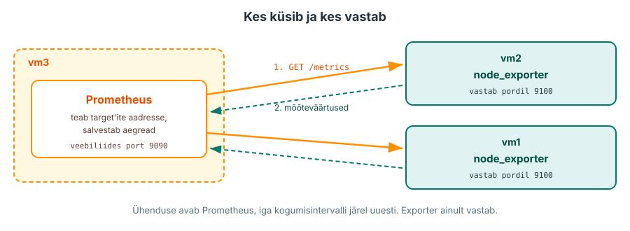
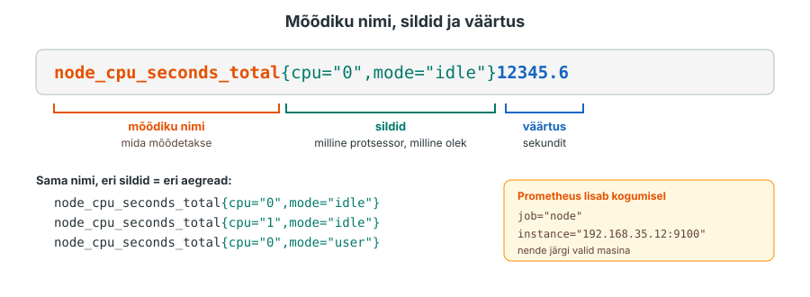
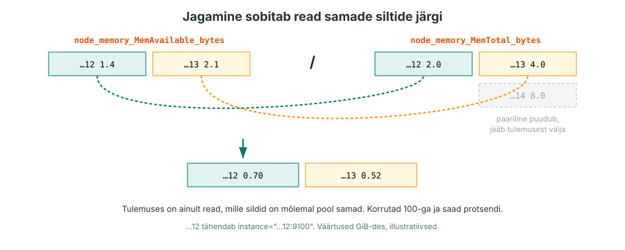
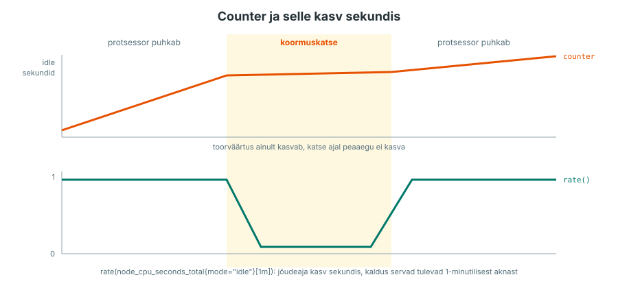

---
tags:
  - Loeng
  - Monitooring
  - Prometheus
  - Grafana
---

# Loeng: mõõdikud ja töölaud

DevOps Lite'is paigaldasid Ansible'i ja Compose'iga teenused kolme masinasse. Täna paned need masinad jälgimise alla: node_exporter avaldab iga masina mõõdikud, Prometheus küsib need ise ja salvestab, päringud koostad PromQL-iga ja Grafana näitab tulemust töölaual. Kogu kohtumise läbiv küsimus on: **millises masinas on ressursse kõige vähem alles?**

??? abstract "Õpiväljundid"
    Pärast loengut ja praktikumi oskad:

    - eristada mõõdikut, logi ja jälge ning selgitada, millist küsimust igaüks aitab vastata;
    - selgitada, kes avab ühenduse ja milline komponent tagastab väärtused Prometheuse puhul;
    - lugeda exporter'i väljundist mõõdiku nime, silte, väärtust, tüüpi ja ühikut;
    - kontrollida kogumist sammhaaval: exporter, `/metrics`, Targets-leht, päring;
    - koostada PromQL-i päringuid saadaval oleva mälu, failisüsteemi vaba ruumi ja protsessori kasutuse uurimiseks;
    - lisada Grafanasse andmeallika ja paneeli oma päringuga.

## 1. Mõõdik, logi ja jälg

Teenus võib olla käivitatud ja ikkagi kasutaja jaoks katki: ketas on täis, mälu on otsas või päring võtab 30 sekundit. Monitooring kogub andmeid, mille põhjal seda märgata enne kasutajat ja leida põhjus. Andmeid on kolme liiki ja igaüks vastab eri küsimusele.

??? note "Tabel 1.1. Kolm andmeliiki ja kursuse kohtumised"
    | Andmeliik | Mis see on | Küsimus, millele vastab | Kohtumine |
    |---|---|---|---|
    | **mõõdik** | arv ajas, näiteks vaba mälu baitides iga 15 sekundi järel | kui palju ja kas muutub? | K1, K2 |
    | **logi** | sündmuse tekstikirje ajatempliga | mis juhtus ja millal? | K3 |
    | **jälg** (trace) | ühe päringu teekond läbi teenuste koos iga sammu kestusega | kus päring aega kulutas? | K4 |

Mõõdikud on kõige odavamad koguda ja hoida, seega alustatakse neist. Logid ja jäljed vajad siis, kui mõõdik näitab probleemi ja on vaja teada, mis selle põhjustas.

<figure markdown="span">
  
  <figcaption>Joonis 1.1. Prometheuse ülesehitus: kogumine, aegridade andmebaas ja PromQL ([Prometheuse ülevaade](https://prometheus.io/docs/introduction/overview/)) (Talvik, 2026).</figcaption>
</figure>

## 2. Kes avab ühenduse

Mõõdikute kogumisel on kaks küsimust: kes avab ühenduse ja milline komponent tagastab väärtused. Prometheuse puhul avab ühenduse Prometheus ja exporter tagastab korraga kõik oma mõõdikud. Seda nimetatakse **pull-mudeliks**. Kui jälgitav masin saadab andmed ise keskserverisse, on see **push-mudel**: nii töötavad näiteks Zabbixi aktiivne agent, Telegraf ja OpenTelemetry (K4).

Pull-mudelis peab jälgitavas masinas olema port lahti ja server peab teadma kõiki aadresse. Push-mudelis peab lahti olema serveri port ja jälgitav masin peab teadma serveri aadressi. Pull-mudeli eelis on see, et Prometheus märkab kohe, kui target ei vasta.

<figure markdown="span">
  
  <figcaption>Joonis 1.2. Prometheus küsib jälgitavate masinate node_exporteritelt mõõdikuid. Ühenduse avab Prometheus, exporter ainult vastab (Talvik, 2026).</figcaption>
</figure>

??? question "Kontrolli ennast"
    Jälgitav masin on tulemüüri taga, kuhu väljast ühendusi sisse ei lubata. Kas Prometheus saab sealt andmeid küsida? Millist mudelit sellises olukorras kasutaksid?

    ??? success "Vastus"
        Ei saa, sest pull-mudelis avab ühenduse Prometheus. Sellises olukorras sobib push-mudel: masin saadab andmed ise väljapoole, mida tulemüür tavaliselt lubab.

## 3. Exporter ja /metrics

**Exporter** on programm, mis loeb mõõdikud ja avaldab need HTTP-aadressil `/metrics`. Masina näitude jaoks on [node_exporter](https://github.com/prometheus/node_exporter). See loeb Linuxi tuuma faile kaustades `/proc` ja `/sys`, kust samu numbreid loevad ka käsud `free`, `df` ja `top`.

Exporter'i väljund on tekst. Väike väljavõte node_exporterist:

```text
# HELP node_memory_MemAvailable_bytes Memory information field MemAvailable_bytes.
# TYPE node_memory_MemAvailable_bytes gauge
node_memory_MemAvailable_bytes 1.473433600e+09
# HELP node_filesystem_avail_bytes Filesystem space available to non-root users in bytes.
# TYPE node_filesystem_avail_bytes gauge
node_filesystem_avail_bytes{device="/dev/sda2",fstype="xfs",mountpoint="/"} 1.2034e+10
# HELP node_cpu_seconds_total Seconds the CPUs spent in each mode.
# TYPE node_cpu_seconds_total counter
node_cpu_seconds_total{cpu="0",mode="idle"} 81432.17
```

<figure markdown="span">
  
  <figcaption>Joonis 1.3. Mõõdiku nimi ja sildid ehk label'id valivad päringu jaoks õige aegrea. Prometheus lisab kogumisel sildid `job` ja `instance` (Talvik, 2026).</figcaption>
</figure>

Mõõteväärtuse real on mõõdiku **nimi** (`node_filesystem_avail_bytes`) ja **väärtus** (`1.2034e+10`). Kui mõõdikul on **sildid** ehk label'id, on need nime järel loogelistes sulgudes (`mountpoint="/"`), mälumõõdikul neid pole. `e+10` tähendab korrutamist arvuga 10¹⁰. Read `# TYPE` ja `# HELP` kirjeldavad mõõdiku tüüpi ja tähendust. Ühik on nime lõpus: `_bytes` tähendab baite ja `_seconds_total` sekundeid kokku.

Mõõdikutüüpe on kaks, mida täna kasutad ([Metric types](https://prometheus.io/docs/concepts/metric_types/)). **Gauge** on hetkeväärtus, mis võib tõusta ja langeda, näiteks vaba mälu. **Counter** ainult kasvab ja lähtestub nulli alles masina taaskäivitusel, näiteks protsessori jõudeaeg sekundites alates käivitusest. Prometheuse tavade järgi lõpeb counteri nimi järelliitega `_total`.

??? question "Kontrolli ennast"
    `/metrics` avaneb sinu brauseris aadressil `http://<vm2-IP>:9100/metrics`. Kas see tõendab, et Prometheus saab samast aadressist koguda?

    ??? success "Vastus"
        Ei tõenda. Brauser ühendub klassiarvutist, Prometheus aga vm3 konteinerist. Teel võivad olla teised tulemüürireeglid ja `prometheus.yml`-is võib olla vale aadress või port. Kogumist tõendab Prometheuse **Targets**-leht ja päring, mis leiab aegrea.

## 4. Target, scrape ja silt

Prometheus loeb oma seadeid failist `prometheus.yml`. Seal on kirjas, keda küsida ja kui tihti. Näite aadressid asenda oma laborimasinate aadressidega:

```yaml
global:
  scrape_interval: 15s

scrape_configs:
  - job_name: node
    static_configs:
      - targets: ["192.168.125.21:9100", "192.168.125.22:9100"]
```

**Target** on üks aadress, kust mõõdikuid küsitakse. **Scrape** on üks küsimine ja `scrape_interval` ütleb, kui tihti seda tehakse. Prometheus lisab igale mõõdikule kaks silti: `job`, siin `node`, ja `instance`, mis on target'i aadress. Iga kogumise järel salvestab Prometheus ka mõõdiku `up`: `1` tähendab, et kogumine õnnestus, ja `0`, et ebaõnnestus. `up=1` ei tõenda, et jälgitav rakendus töötab kasutaja jaoks õigesti.

<figure markdown="span">
  
  <figcaption>Joonis 1.4. Iga kogumine lisab aegreale punkti ja salvestab mõõdiku up. Väärtused on illustratiivsed (Talvik, 2026).</figcaption>
</figure>

<figure markdown="span">
  
  <figcaption>Joonis 1.5. Mida Prometheus salvestab: nimi, sildid ja ajatempel kokku on võti, millele kuulub mõõdetud väärtus (Talvik, 2026).</figcaption>
</figure>

Mõõdiku nimi koos siltide väärtustega määrab ühe **aegrea**. Kui masin avaldab iga loogilise protsessori kohta kaheksa `mode` väärtust, tekib kahe loogilise protsessori korral `node_cpu_seconds_total` jaoks 16 aegrida. Kaks sellist masinat annavad 32 aegrida.

??? question "Kontrolli ennast"
    Lisad `prometheus.yml`-i kolmanda masina, kus on neli loogilist protsessorit ja samad kaheksa `mode` väärtust. Mitu uut aegrida lisandub mõõdikule `node_cpu_seconds_total`?

    ??? success "Vastus"
        32: neli protsessorit korda kaheksa `mode` väärtust.

## 5. Kuidas kogumist kontrollida

Kui päring ei leia midagi, võib viga olla viies kohas. Kontrolli neid järjest, sest iga samm eeldab eelmist.

??? note "Tabel 1.2. Kogumise kontroll sammhaaval"
    | Samm | Kus | Kuidas kontrollid | Mida tulemus tõendab |
    |---|---|---|---|
    | 1. Exporter töötab | jälgitav masin | `systemctl is-active node_exporter` | systemd peab teenust aktiivseks |
    | 2. `/metrics` on kättesaadav | jälgitav masin, siis vm3 | `curl -s localhost:9100/metrics`, siis ühendus vm3-st | mõõdikud on olemas ja port on võrgus lahti |
    | 3. Prometheus kogub | **Status → Target health** | olek UP, **Last scrape** värske, **Error** tühi | Prometheus jõuab target'ini |
    | 4. Päring leiab aegread | **Query** | siltide hulgas on mõlemad oodatud target'id | andmed on salvestatud |
    | 5. Tulemus vastab küsimusele | **Query** | ühik ja sildid: masin, failisüsteem | vaatad õiget asja |

    Kui olek on DOWN, ütleb **Error**, mis juhtus, näiteks `connection refused` või `context deadline exceeded`.

<figure markdown="span">
  
  <figcaption>Joonis 1.6. Kogumise kontroll: alusta sealt, kus esimene kontroll ebaõnnestub (Talvik, 2026).</figcaption>
</figure>

??? question "Kontrolli ennast"
    Targets-lehel on vm1 olekus DOWN ja **Error** on `connection refused`. vm2 on UP. Millise sammu juurest alustad ja mida kontrollid vm1-s?

    ??? success "Vastus"
        Võrk vm3 ja vm1 vahel töötab, sest vm1 vastas, aga keeldus ühendusest. Alusta sammust 1: kas `node_exporter` töötab vm1-s. Kui töötab, kontrolli sammu 2: kas port 9100 on tulemüüris lahti.

## 6. PromQL kolme küsimuse kaudu

Prometheuse päringukeel on [PromQL](https://prometheus.io/docs/prometheus/latest/querying/basics/). Päringu kirjutad Prometheuse veebiliideses lehel **Query** või Grafana paneelis. Praktikumis koostad päringud kolmele küsimusele ja iga küsimus lisab päringukeelest ühe osa.

**Kui palju mälu on masinas saadaval?** Kõige lihtsam päring on mõõdiku nimi. See tagastab viimase väärtuse igast aegreast, seega iga masina kohta ühe rea. Sildifilter loogelistes sulgudes piirab tulemuse ühe masinaga. Osakaalu saad, kui jagad saadaval oleva mälu kogu mäluga. Need on kaks eraldi päringut:

```text
node_memory_MemAvailable_bytes{instance="192.168.125.21:9100"}
node_memory_MemAvailable_bytes / node_memory_MemTotal_bytes * 100
```

Jagamine paneb kokku read, millel on samad sildid, seega saad iga masina kohta ühe protsendi.

<figure markdown="span">
  
  <figcaption>Joonis 1.7. Sildifilter valib aegread, jagamine paaritab read samade siltide järgi. Väärtused on illustratiivsed (Talvik, 2026).</figcaption>
</figure>

<figure markdown="span">
  
  <figcaption>Joonis 1.8. Jagamine sobitab read samade siltide järgi (Talvik, 2026).</figcaption>
</figure>

Sildifiltris saab kasutada nelja operaatorit ([Querying basics](https://prometheus.io/docs/prometheus/latest/querying/basics/#time-series-selectors)):

??? note "Tabel 1.3. Sildifiltri operaatorid"
    | Operaator | Tähendus | Näide |
    |---|---|---|
    | `=` | võrdne | `node_filesystem_avail_bytes{mountpoint="/"}` |
    | `!=` | ei ole võrdne | `node_filesystem_avail_bytes{mountpoint!="/boot"}` |
    | `=~` | vastab regulaaravaldisele | `node_filesystem_avail_bytes{fstype=~"xfs\|ext4"}` |
    | `!~` | ei vasta regulaaravaldisele | `node_filesystem_avail_bytes{mountpoint!~"/run.*"}` |

**Millises masinas on juurfailisüsteemis kõige vähem vaba ruumi?** Masinas on mitu failisüsteemi ja `node_filesystem_avail_bytes` annab rea igaühe kohta. Õige failisüsteemi valid sildiga `mountpoint="/"`. Vaba ruumi osakaal tuleb samamoodi nagu mälu puhul, jagades suurusega `node_filesystem_size_bytes`.

<figure markdown="span">
  
  <figcaption>Joonis 1.9. Instant vector annab ühe väärtuse, range vector `[1m]` annab väärtused ajavahemikus (Talvik, 2026).</figcaption>
</figure>

**Kuidas muutub protsessori kasutus koormuskatse ajal?** `node_cpu_seconds_total` on counter. Counteri toorväärtus ütleb ainult, kui palju aega on kokku kulunud, kiiruse saamiseks loetakse kaks väärtust ja jagatakse vahe ajaga. Funktsioon `rate()` arvutab ajavahemiku `[1m]` väärtuste põhjal counteri keskmise kasvu sekundis ja arvestab ka counteri lähtestumist ([rate()](https://prometheus.io/docs/prometheus/latest/querying/functions/#rate)). Kasuta seda counterite, mitte gauge'ide jaoks. Jõudeoleku (`mode="idle"`) kasv on iga protsessori kohta 0 ja 1 vahel. `avg by (instance)` arvutab iga masina loogiliste protsessorite keskmise ja `100 * (1 - ...)` teeb sellest kasutuse protsendi.

<figure markdown="span">
  
  <figcaption>Joonis 1.10. Counteri toorväärtus ja selle kasv sekundis koormuskatse ajal. Väärtused on illustratiivsed (Talvik, 2026).</figcaption>
</figure>

```text
node_cpu_seconds_total{mode="idle"}
rate(node_cpu_seconds_total{mode="idle"}[1m])
avg by (instance) (rate(node_cpu_seconds_total{mode="idle"}[1m]))
100 * (1 - avg by (instance) (rate(node_cpu_seconds_total{mode="idle"}[1m])))
```

<figure markdown="span">
  
  <figcaption>Joonis 1.11. Protsessori kasutuse päring tekib neljas sammus: loendur, kasv sekundis, keskmine masina kohta ja jõudeajast üle jäänud aja osakaal protsentides. Väärtused on illustratiivsed (Talvik, 2026).</figcaption>
</figure>

15-sekundilise kogumisintervalli juures kasutame üheminutilist akent. Mitut mõõtmist hõlmav aken teeb tulemuse stabiilsemaks, pikem aken silub lühikesi muutusi rohkem. Uus mõõtmine mõjutab tulemust kohe, aga täielikult jõuab muutus tulemusse alles akna jooksul.

Võrdlus, näiteks `< 20`, jätab alles ainult read, mille kohta tingimus kehtib. Sellest tuleb K2-s alarmireegel.

<figure markdown="span">
  
  <figcaption>Joonis 1.12. Võrdlus filtreerib read: alles jäävad ainult need, mille kohta tingimus kehtib (Talvik, 2026).</figcaption>
</figure>

??? question "Kontrolli ennast"
    1. Mida näitab päringu `node_cpu_seconds_total` graafik ja miks vajad kasutuse uurimiseks teistsugust päringut?
    2. Kas `[1m]` tähendab, et pärast koormuse algust peab minut ootama, enne kui tulemus üldse muutub?
    3. Mis on päringu `node_memory_MemAvailable_bytes / node_memory_MemTotal_bytes * 100` tulemuse ühik ja ulatus?

    ??? success "Vastused"
        1. Pidevalt kasvavat jõudeaja summat sekundites. Sellest ei näe, kui koormatud masin praegu on, vaja on kasvu kiirust (`rate()`).
        2. Ei. Uus mõõtmine mõjutab tulemust kohe, aga täielikult jõuab muutus tulemusse alles umbes minuti jooksul.
        3. Protsent, iga masina kohta arv 0 ja 100 vahel.

## 7. Grafana: andmeallikas, paneel ja töölaud

Prometheuse veebiliides sobib päringu koostamiseks ja kontrollimiseks. Igapäevaseks vaatamiseks kasutatakse [Grafanat](https://grafana.com/docs/grafana/latest/): see küsib andmed Prometheusest ja näitab neid töölaual. Grafana ise mõõdikuid ei kogu ega salvesta.

**Andmeallikas** (data source) ütleb Grafanale, kust andmeid küsida, näiteks `http://prometheus:9090`. Selle saab lisada veebiliideses või kirjeldada failis, mille Grafana käivitusel loeb ([Provisioning](https://grafana.com/docs/grafana/latest/administration/provisioning/)). Failiga kirjeldatud andmeallikas on Gitis ja tekib ka uues konteineris samamoodi. **Paneel** on üks graafik või number ühe või mitme PromQL-i päringuga. **Töölaud** (dashboard) on paneelide kogum, mida saab salvestada JSON-failina ja teise Grafanasse importida.

Kogukond jagab valmis töölaudu lehel [grafana.com/dashboards](https://grafana.com/grafana/dashboards/). Node Exporter Full (ID 1860) näitab kõiki node_exporteri mõõdikuid. Valmis töölaud on hea ülevaate jaoks, aga konkreetse küsimuse jaoks, näiteks „millises masinas on mälu kõige vähem“, on selgem oma paneel oma päringuga.

??? question "Kontrolli ennast"
    Grafana paneel on tühi ja näitab teadet `No data`. Prometheuse **Query** lehel annab sama päring tulemuse. Kus otsid viga?

    ??? success "Vastus"
        Andmeallikas: kas Grafana jõuab Prometheuseni (**Connections → Data sources → Save & test**) ja kas paneel kasutab õiget andmeallikat. Seejärel paneeli ajavahemik paremal üleval: kui see on enne kogumise algust, pole andmeid.

??? abstract "Kokkuvõte"
    | Mõiste | Lühidalt |
    |---|---|
    | mõõdik, logi, jälg | arv ajas, sündmuse kirje, päringu teekond |
    | pull-mudel | server avab ühenduse ja küsib mõõdikud ise |
    | exporter | programm, mis avaldab mõõdikud aadressil `/metrics` |
    | gauge, counter | hetkeväärtus; ainult kasvav summa |
    | target | aadress, kust Prometheus mõõdikuid küsib |
    | `scrape_interval` | kui tihti Prometheus küsib |
    | silt (label) | nimi ja väärtus mõõdiku juures; mõõdiku nimi koos siltidega määrab aegrea |
    | `up` | 1, kui target'i kogumine õnnestus, 0, kui ebaõnnestus |
    | `rate()` | counteri keskmine kasv sekundis ajavahemikus |
    | `avg by (instance)` | keskmine iga `instance` kohta eraldi |
    | andmeallikas, paneel, töölaud | Grafana: kust andmed tulevad, üks graafik, graafikute kogum |
